# KANIT — feat-defter-ve-yukleme

| Görev | Tür | Aralık | Tur | Yazar modeli |
|---|---|---|---|---|
| PR 4: Yanlış defteri araç çubuğu, Yanlış ekle penceresi, etiket ekranı, soru penceresi | görsel / karma | 9864221..bu turun commit'i | 1 | sonnet |

## İddia
- [x] Defter araç çubuğu: satır 1 arama + "Filtreler" (seçili sayı rozetli) + Liste / Ders › Konu; filtreler (Ders, Sınav, Durum, Hata türü, Ay) açılır panelde; satır 2 "N soru / M toplam" + tek "Dışa aktar" menüsü (Excel, CSV, Yazdır / PDF). Boş "----------" tarih alanı yok; Ay boşken "Tüm aylar".
- [x] "Yazdır / PDF" Defter sayfa başlığında yok (Aylık rapor'da kalır).
- [x] Defter boşken: örnek iskelet + 3 adım + altında tek birincil "İlk yanlışını ekle"; üst çubuk "Yanlış ekle" ikincil; araç çubuğu gizli.
- [x] Kontrol bekleyenler varsa araç çubuğunun üstünde kum şerit "N sorunun dersi ya da konusu belirlenmedi · Kontrol et"; tıklayınca PENDING_FILTER (mevcut `isUnrecognized` sayımı).
- [x] Yanlış ekle: solda kapat (44px), ortada başlık, masaüstü 560px / mobil tam ekran, iki 128px kutu, 3 sütun ızgara, sabit alt çubukta tek birincil; "Yapay zekâ şu an kapalı" ayrı kum bilgi kutusunda (Info ikonu).
- [x] Etiket ekranı: ilerleme çizgileri, kart başına ikincil "Düzenle", emin olunamayan kartta kum zemin + "Kontrol et", altta sabit tek birincil "Tamam, N soru defterde" + açıklama; 390px'te taşma yok, hedefler >=44px.
- [x] Soru penceresi: birincil "Çözümü hazırla", ikincil "Not oluştur", ⋯ menüsünde Yazdır / Düzenle / Sil (sil kırmızı metin, dolgusuz, onaylı).
- [x] Davranış korunur: filtre, arama, ders>konu, dışa aktarma işlevleri, PENDING_FILTER, yükleme akışı, etiket düzenleme.

## Önce
Taban dal (9864221) bileşenleri + CSS'i, geçici `--detach` worktree'den (iş bitince kaldırıldı) aynı önizleme betiğiyle: `*-onceki.png`, `olcum-onceki.json`.
Defter: 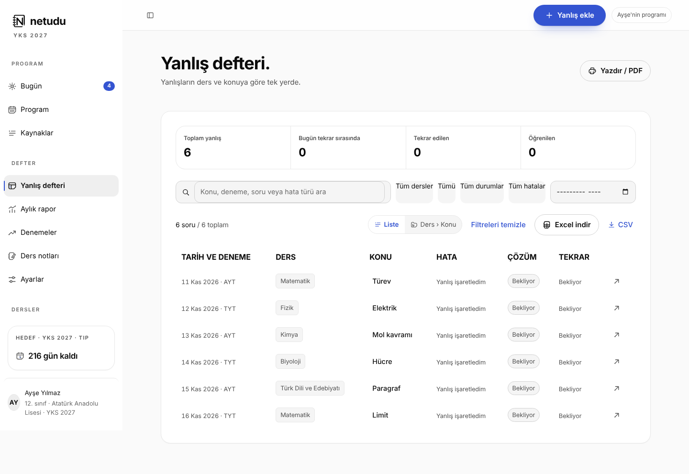 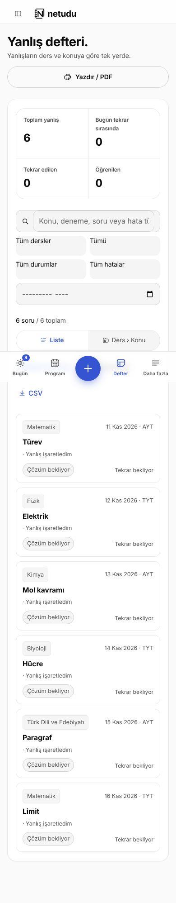 — Yanlış ekle: 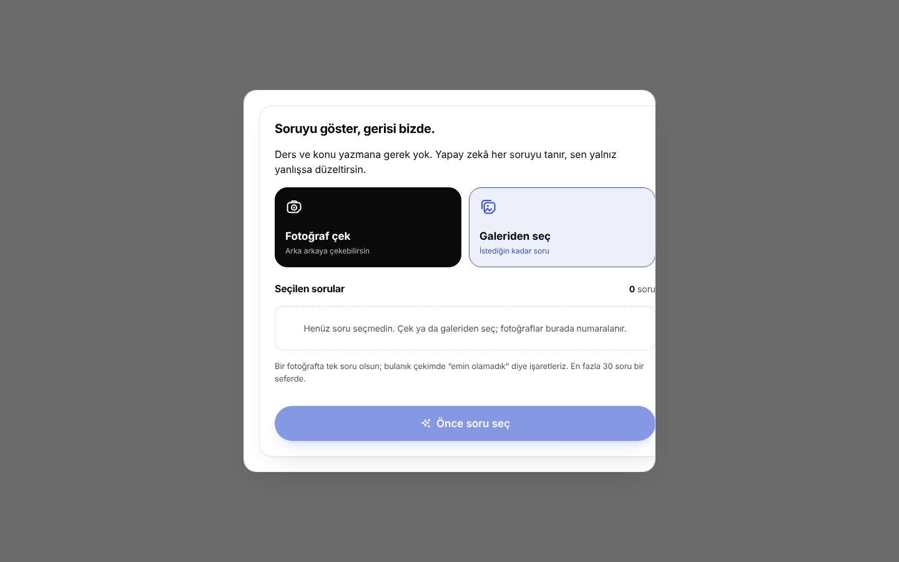 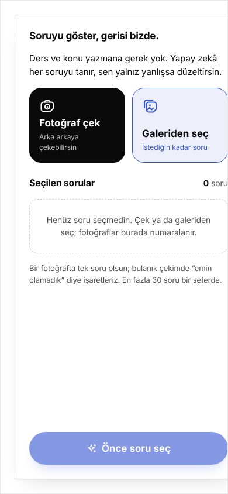 — Etiket: 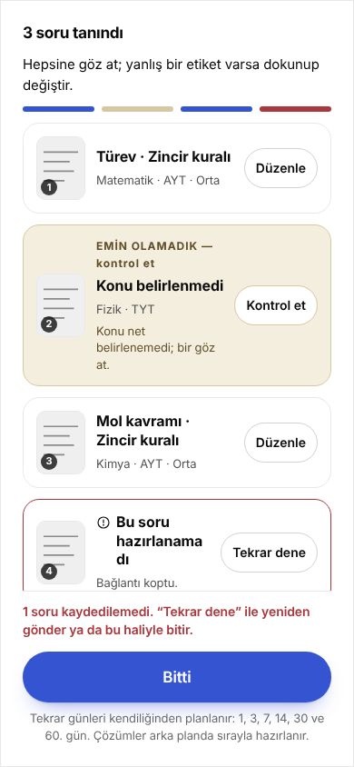 — Soru: 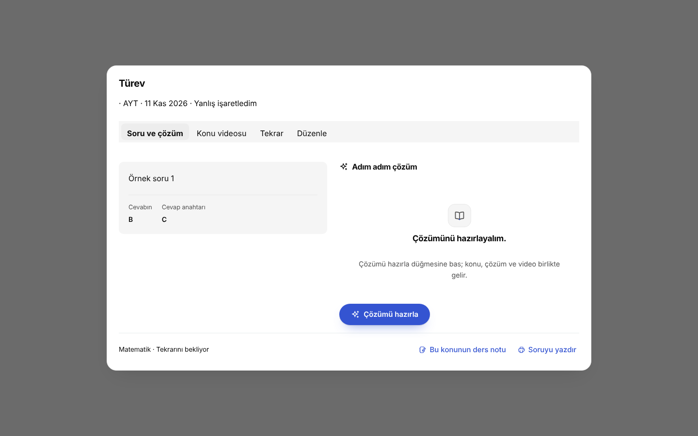
Koyu: aynı adlar `-koyu-onceki.png`; ayrıca `defter-bos-*`, `defter-kontrol-*`, `yukle-ai-kapali-*`, `yukle-fotolu-*`, `defter-filtre-*`.

## Sonra
Defter: 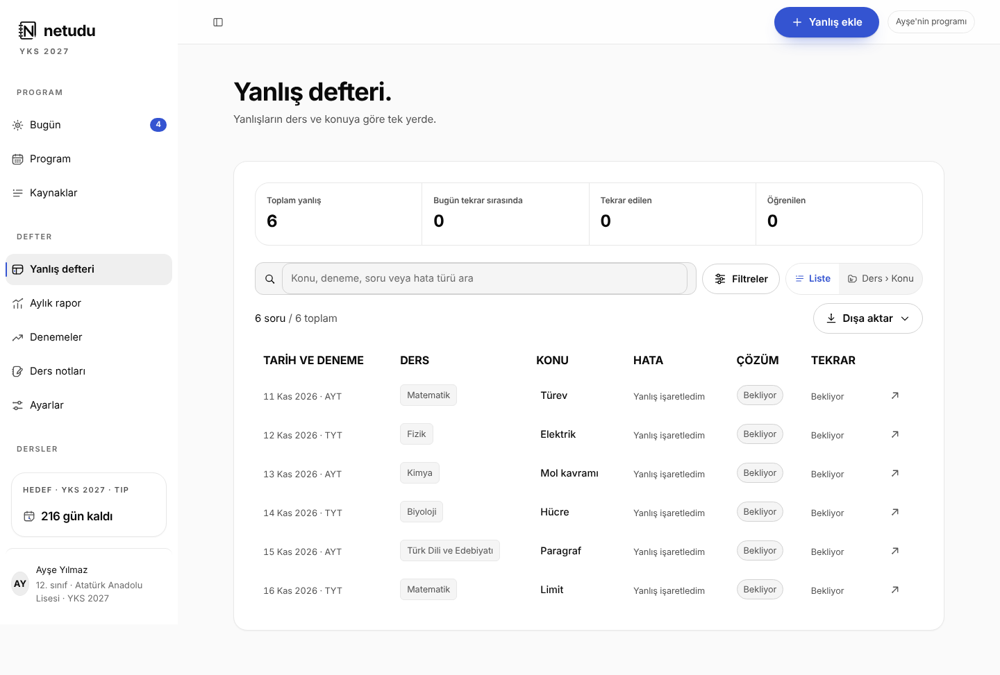 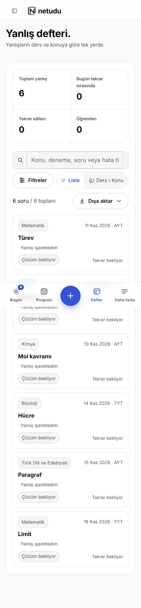 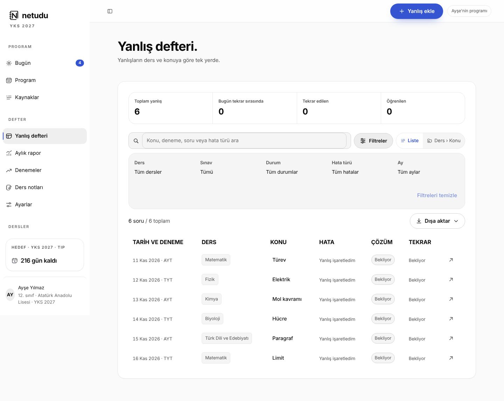 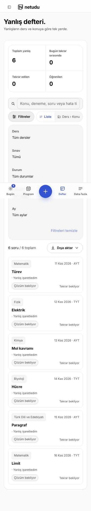 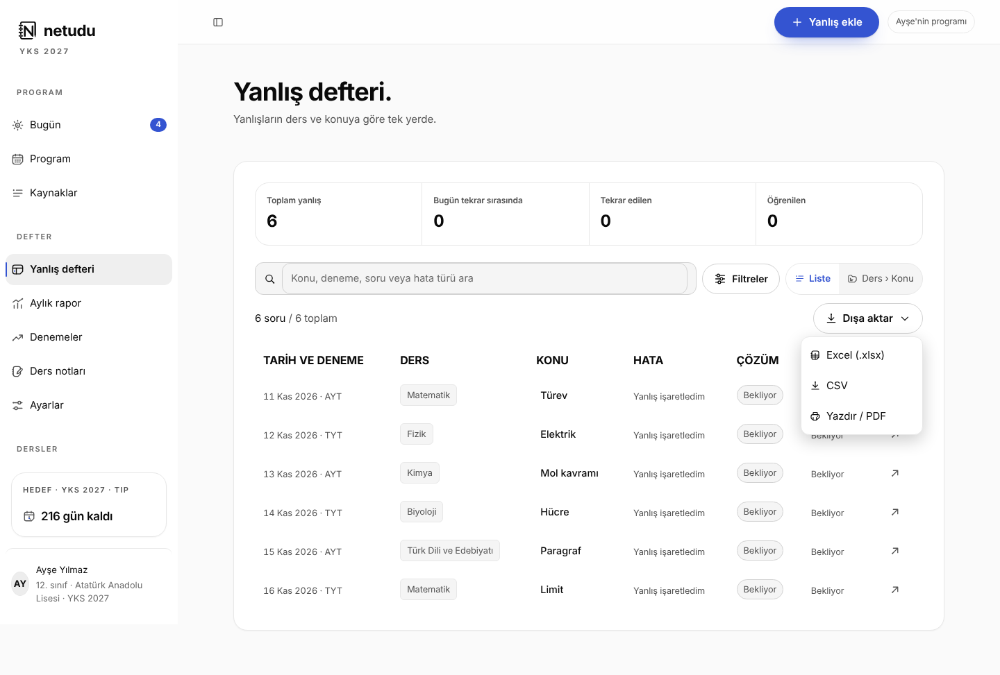
Boş / kontrol şeridi: 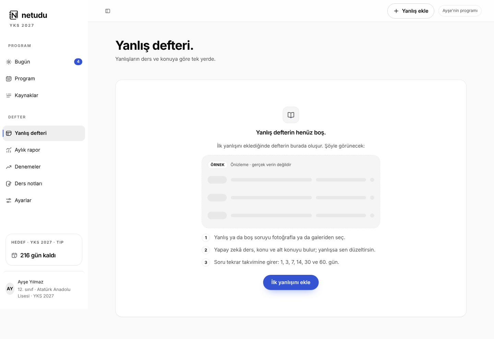 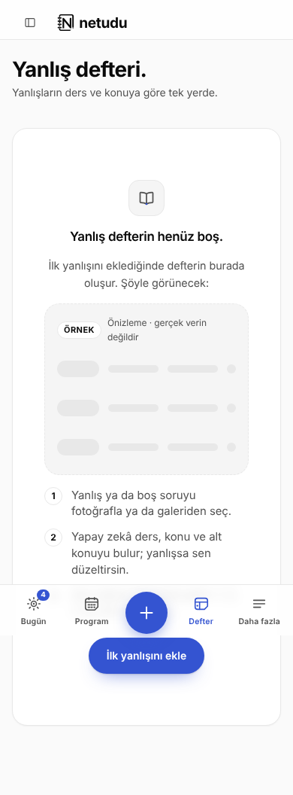 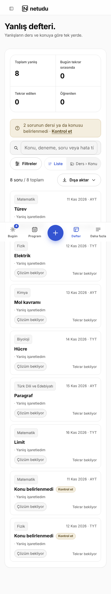
Yanlış ekle: 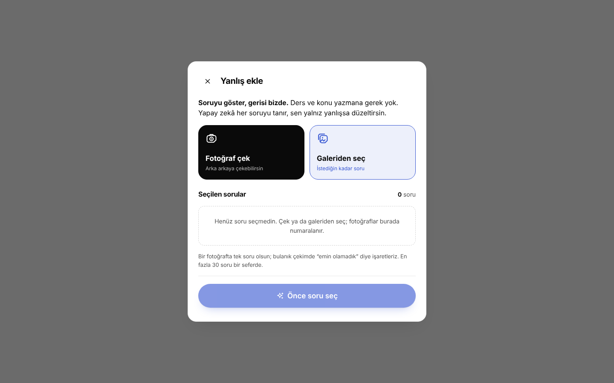 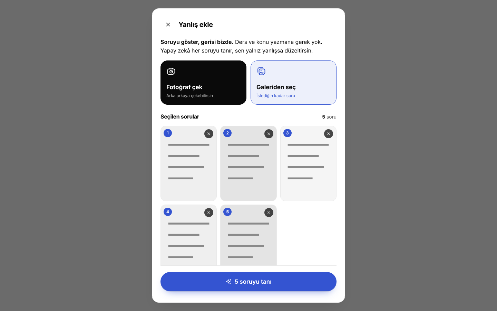 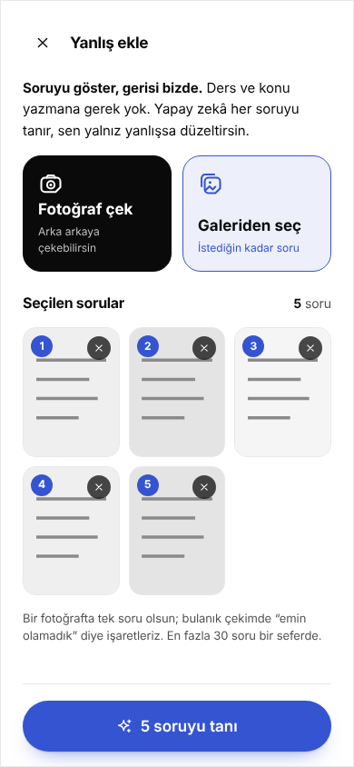 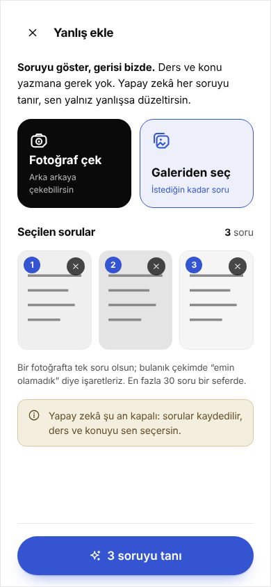
Etiket / soru: 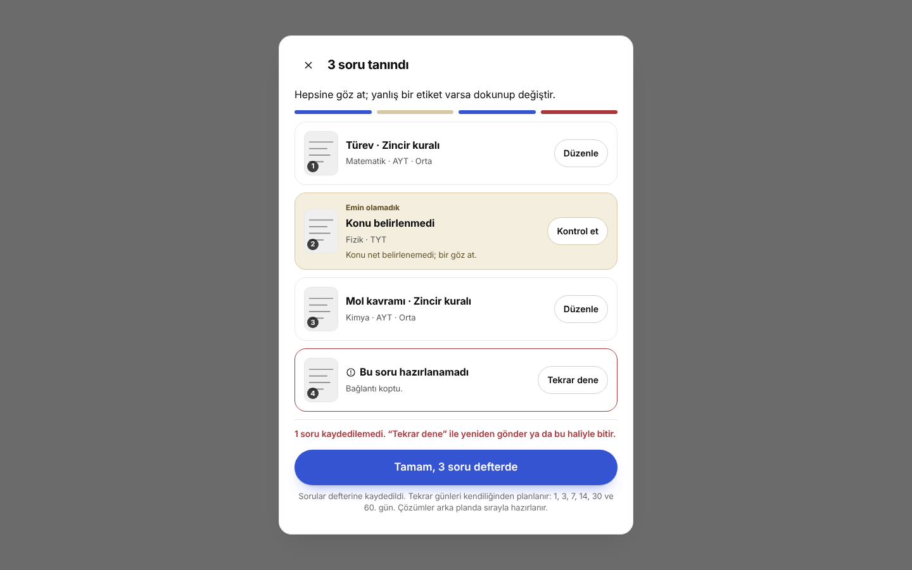 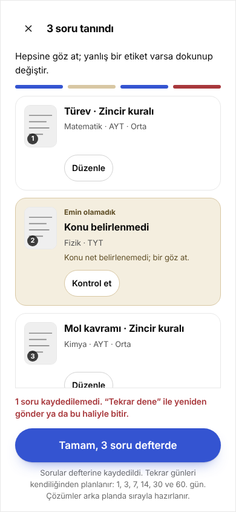 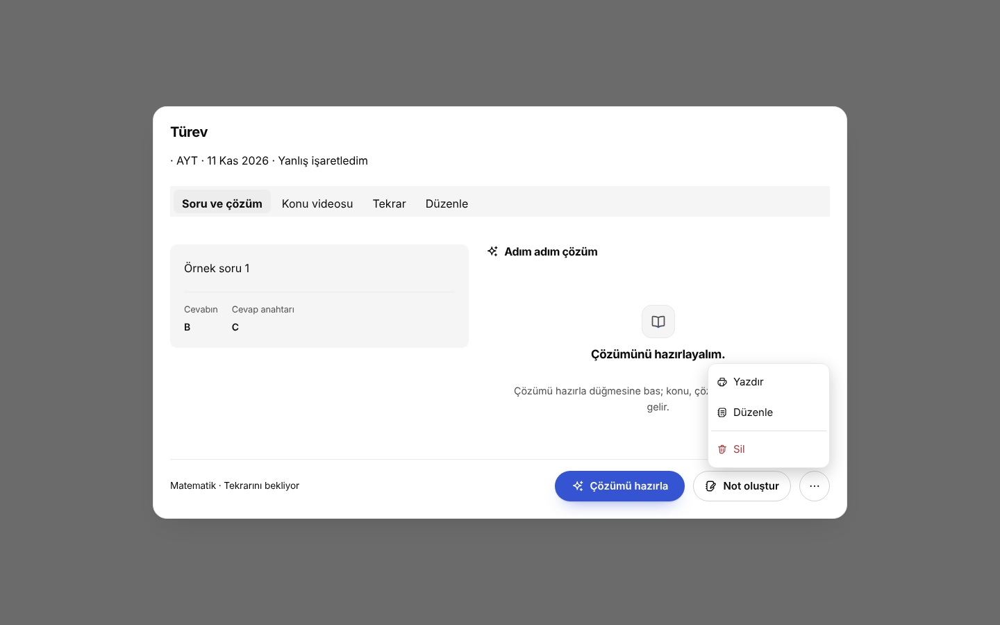 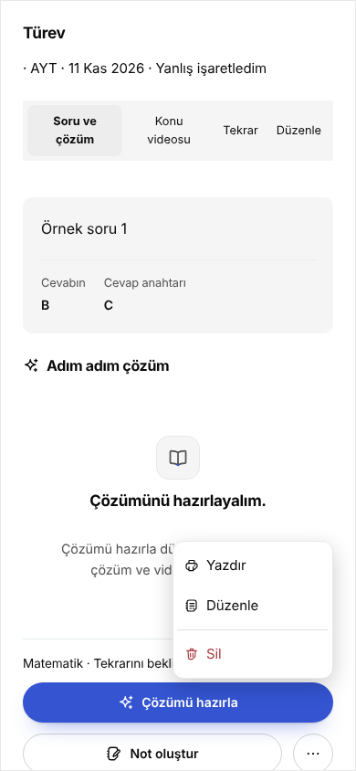
Koyu: her ad için `-koyu-sonraki.png`. Ölçümler: `olcum-sonraki.json`.
Komut: `ND_ROOT=$PWD SRC_ROOT=$PWD MODE=sonraki OUT=$PWD/docs/proof/feat-defter-ve-yukleme PLAYWRIGHT_BROWSERS_PATH=/opt/pw-browsers node scripts/defter-preview.mjs` (önce: `ND_ROOT=<taban worktree> MODE=onceki`).

## "Güncel CSS ile gerçek sorun var mıydı?" (önizleme ölçümü)
| Madde | Sonuç |
|---|---|
| 1 Araç çubuğu kalabalığı | VARDI: önce tek satırda arama + 4 seçici + ay alanı, ardından ikinci satırda görünüm + temizle + Excel + CSV; ay alanı boşken "---------- ----" (defter-1440-acik-onceki.png). Masaüstünde Liste/Ders›Konu 37px, "Filtreleri temizle" 36px, CSV 36px (<44). Sonra: satır 1 üç öğe, panel kapalı; ölçüm `olcum-sonraki.json` defter-1440-acik: arama/Filtreler/görünüm aynı satırda (y 378/380/379); 390px'te Filtreler 112x44, Dışa aktar 154x44. Masaüstü kalan küçük hedefler yalnız tablo içi ("Türev" 24px, ok düğmesi 36px) ve önceden vardı; kapsam dışı bırakıldı. |
| 2 Boş durum | KISMEN VARDI: örnek iskelet + 3 adım zaten vardı, birincil yoktu (kobalt yalnız üst çubukta). Sonra: masaüstü boş Defter'de kobalt yalnız "İlk yanlışını ekle" (olcum-sonraki.json defter-bos-1440-acik); 390px'te mobil "+" FAB (koordinatör kararı: gezinme öğesi) ikinci kobalt olarak ölçülür. |
| 3 Kontrol bekleyenler | VARDI ama yalnız Ders seçicisinin içinde gizliydi; şerit yoktu. Sonra: defter-kontrol-*.png. |
| 4 Yükleme penceresi | KISMEN VARDI: iki kutu 128px, ızgara, sabit alt çubuk zaten güncel CSS'teydi. Eksik/yanlış olanlar: genişlik 660px (olcum-onceki yukle-bos-1440: 660; sonra 560), kapat sağ üstte ve başlık solda, "Yapay zekâ kapalı" açıklamaya gömülüydü, masaüstü ızgara 4 sütundu (sonra 3), sabit alt çubuğun altından içerik görünüyordu. |
| 5 Etiket ekranı | KISMEN VARDI: ilerleme çizgileri, kum kart, Kontrol et/Düzenle, sabit alt çubuk vardı. Eksik: alt düğme "Bitti" idi ("Tamam, N soru defterde" oldu), büyük harfli "EMİN OLAMADIK — kontrol et" / "DÜZENLENİYOR" etiketleri, 390px'te "Bu soru hazırlanamadı" kelime ortasından bölünüyordu (düğme artık gövdenin altında), düzenleme kartında ikinci kobalt "Kaydet" (artık siyah dolgu). |
| 6 Soru penceresi | VARDI: birincil çözüm panel içinde, "ders notu" ve "yazdır" metin düğmeleri alt satırda, silme düzenle sekmesindeydi (kırmızı metin dolgusuz zaten). Sonra tek eylem satırı + ⋯ menüsü. |

## Test / Ölçüm
| Komut | Beklenen | Gerçek | Çıkış kodu | Sonuç |
|---|---|---|---|---|
| `ND_ZOD_PATH=/opt/npm-tools/node_modules/zod/index.js npm test` | tümü yeşil | tests 61, pass 61, fail 0, skipped 0 | 0 | PASS |
| `scripts/defter-preview.mjs` (1440/390, açık/koyu) | sw==cw, 390'ta küçük hedef yok, taşma yok | tüm ekranlarda sw==cw ve `tasan` 0; 390'ta `kucukHedef` boş (defter, yükle, etiket, soru) | 0 | PASS |
Yeni saf mantık testleri `tests/archive-filters.test.mjs` (6), `tests/shell.test.mjs` (pageActions, topbarAddVariant boş/yükleniyor), SSR `tests/shell-render.test.mjs` (+10: Filtreler, tek Dışa aktar, panel, boş durum, şerit, yükleme, bilgi kutusu, etiket, soru penceresi), `tests/css-split.test.mjs` (+1). Saf mantık testleri önce kırmızı koşuldu (modül yok / eski pageActions); SSR ve CSS testleri işaretleme/CSS sonrası eklendi (kırmızı kanıtı yok).

## Tur 2 (inceleme SKOR 3 bulguları)
- [x] ENGELLEYİCİ: Soru penceresi sekmesi artık soru kimliğine bağlı. `lib/dialog-tab.ts` (`syncTab`/`pickTab`) bileşende render sırasında uygulanır; aynı id ile yeni nesne (upsert: Tekrar eylemleri, video, Düzenle'de Kaydet, arka plan çözümü) sekmeyi korur, farklı soru ya da kapanış sıfırlar. `[q]` efektinde yalnız `setEdit`/`setActiveIdx` kaldı.
- [x] Etiket ekranı birincil düğmesi "Tamam, N soru defterde"; alt açıklama "Sorular defterine kaydedildi. ..." ile başlar.
- [x] Kontrol şeridi metni nötr: "N sorunun dersi ya da konusu belirlenmedi · Kontrol et".
- [x] Filtre aktif + panel kapalı + sonuç yokken boş durumda "Filtreleri temizle"; `aria-controls` yalnız panel açıkken.
- [x] `monthValues` boş/bozuk tarihi süzer (`/^\d{4}-\d{2}/`).
- [x] SlidersHorizontal üç satırlı, farklı konumlu düğümlü glif (Settings'ten ayrışır, mürekkep noktası yok); `glyphs.ts` ve `index.tsx`'te alfabetik yerinde (Sigma'dan sonra).
- [x] etiket-390 alt kenardaki kırmızı çerçeve: negatif bottom/margin-bottom kaldırıldı; pencere alt iç boşluğu sabit çubuğa devredildi (`.upload-dialog:has(.cap-foot,.tag-foot){padding-bottom:0}` + çubukta `bottom:0` ve kendi alt dolgusu). `etiket-390-acik-sonraki.png` ve `yukle-fotolu-390-acik-sonraki.png` yeniden üretildi, alt kenarda artık taşan çerçeve yok.

Testler (önce kırmızı): `tests/dialog-tab.test.mjs` (4, modül yokken kırmızı), `archive-filters` (şerit metni, bozuk tarih), `shell-render` (etiket düğmesi, şerit, temizle eylemi + aria-controls). Sonuç: `npm test` 66/66, çıkış 0. Sınırlama: sekme mantığı saf yardımcı olarak sınandı; bileşenin gerçek tarayıcıda yeniden çizimi (Radix Tabs) bu ortamda koşturulamaz, Vercel önizlemesinde teyit edilecek.
Önizlemeler yeniden üretildi (tüm ekranlar, `olcum-sonraki.json`: 40/40 ölçümde `tasan` 0).

## Orkestratör doğrulaması

- `ND_ZOD_PATH=/opt/npm-tools/node_modules/zod/index.js npm test` yeniden koşuldu: 61/61, çıkış 0.
- Gerçek Next/Tailwind/Radix derlemesi bu ortamda yok; DropdownMenu, silme onayı ve ⋯ menüsü Vercel önizlemesinde teyit edilecek.

## Kapsam dışı / bilinen eksikler
- Önizleme: Next/Tailwind yok; Radix bileşenleri (Dialog, Select, Tabs, DropdownMenu, AlertDialog) düz karşılık; pencere konumlandırması elle; yazı tipi Manrope değil; arama alanı çift çerçevesi ve seçicilerin çıplak görünümü önizleme artefaktıdır (önce/sonra aynı). Açılır menü ve silme onayı gerçek tarayıcıda denenmedi.
- Mobil "+" FAB kobalt kalır (PR 3 kararı); boş Defter 390px'te iki kobalt ölçülür.
- Tablo içi küçük hedefler (topic-button 24px, ok 36px) ve Soru penceresi sekmeleri (34px, önizleme stub'ı) bu PR dışı.
- Filtre paneli mobilde ayrı Sheet değil, araç çubuğunun altında tam genişlik satır içi paneldir.
- Çözüm/yapay zekâ davranışı, API ve DB değişmedi; tsc/lint bu ortamda koşturulmadı (bağımlılıklar yok).

## Yeniden üretme
1. Bu turun commit'ini checkout et (SHA: REVIEW-<n>.md başlığı / PR head'i).
2. `ND_ZOD_PATH=/opt/npm-tools/node_modules/zod/index.js npm test`
3. `ND_ROOT=$PWD SRC_ROOT=$PWD MODE=sonraki OUT=$PWD/docs/proof/feat-defter-ve-yukleme PLAYWRIGHT_BROWSERS_PATH=/opt/pw-browsers node scripts/defter-preview.mjs`

## Orkestratör doğrulaması (Tur 2)

- `ND_ZOD_PATH=/opt/npm-tools/node_modules/zod/index.js npm test` yeniden koşuldu: 66/66, çıkış 0 (Tur 1: 61/61).
- Gerçek Radix Tabs/DropdownMenu/AlertDialog davranışı bu ortamda denenemedi; Vercel önizlemesinde teyit edilecek (Tekrar sekmesinde işaretleme sonrası sekmenin kalması, ⋯ menüsünden silme onayı).
