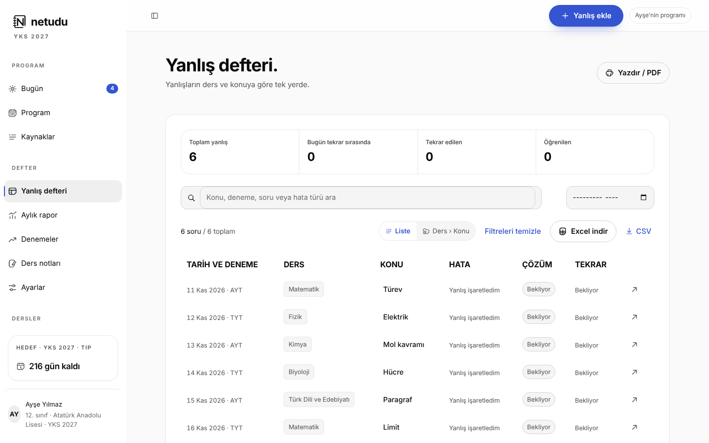
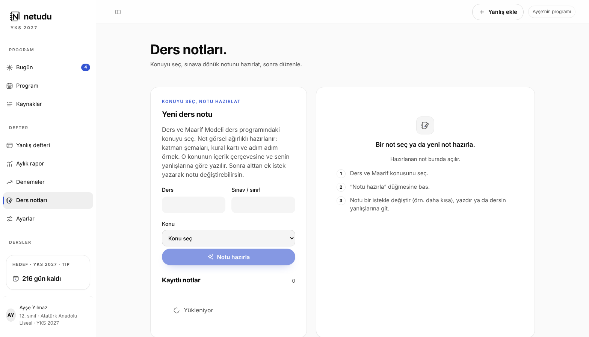
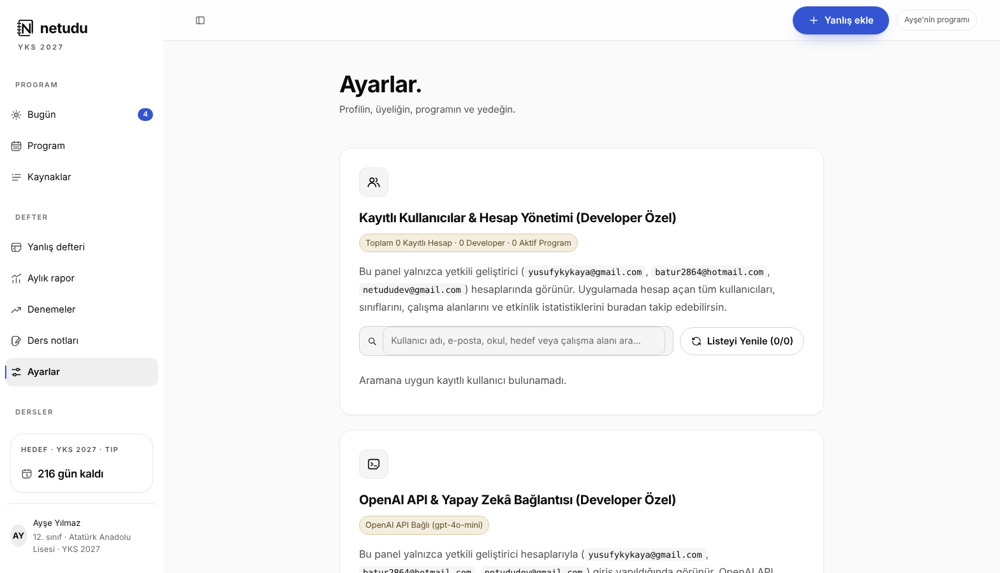

# KANIT — feat-kabuk-ve-giris

| Görev | Tür | Aralık | Tur | Yazar modeli |
|---|---|---|---|---|
| PR 3: kabuk (üst çubuk, kenar çubuğu, başlık, genişlik) + giriş sayfası | görsel / karma | feat/tasarim-sistemi (taban dal ucu)..bu turun commit'i | 1 | sonnet |

## İddia
- [x] Üst çubukta kırıntı ve sayfa başlığında büyük harfli eyebrow yok; yalnız h1 + tek satır açıklama.
- [x] `.workspace` masaüstünde 1120px ortalı; Ayarlar `.view` düzeyinde 760px (başlıkla birlikte); Notlar iki sütunlu olduğu için geniş (1024 içerik); 1568px'te yan boşluklar eşit (96/96).
- [x] "Programı oluştur" kenar çubuğu gezinmesinde yok; program yokken Bugün boş durumunda birincil olarak zaten var.
- [x] Üst çubuk sağı: tek "Yanlış ekle" (Plus) + kullanıcı etiketi; Supabase/OpenAI durum düğmeleri kaldırıldı (Ayarlar > Geliştirici'de zaten var); başlık eylem alanında "Yanlış ekle" yok, "Programı düzenle" hayalet.
- [x] Hedef kartı ile kullanıcı satırı arası 16px; tetikleyici 44px.
- [x] Mobil alt çubuk: Bugün, Program, +(56px), Defter, Daha fazla.
- [x] Giriş sayfası: renkli gradyan yok; kahraman 560px metin sütunu + koyu panel; h1 68px/40px; üst çubuk "7 gün ücretsiz dene" siyah dolgu; kobalt yalnız kahraman ve fiyat birincilinde; 390px'te yatay kaydırma yok.

## Önce
Taban kabuğun sözcüğüne kopyası (`before-frame.tsx`) + taban CSS ile üretildi: `*-onceki.png`, `olcum-onceki.json`.
    
Koyu: `defter-1440-koyu-onceki.png`, `defter-390-koyu-onceki.png`, `landing-*-koyu-onceki.png`, `bugun-bos-*-onceki.png`; ayrıca `ayarlar-1568-acik-onceki.png`, `notlar-1568-acik-onceki.png`.

## Sonra
      
Koyu: `*-koyu-sonraki.png`; `bugun-bos-*-sonraki.png`. Ölçümler: `olcum-sonraki.json`.
Komut: `ND_ROOT=$PWD MODE=onceki|sonraki PLAYWRIGHT_BROWSERS_PATH=/opt/pw-browsers node scripts/shell-preview.mjs` (onceki için taban CSS'i gerekir: taban dalın `app/styles/` dizini; bu turda "önce" PNG'ler CSS 80-kabuk-giris.css eklenmeden önce üretildi).

## "Güncel CSS ile gerçek sorun var mıydı?" (madde madde)
| Madde | Sonuç |
|---|---|
| 1 Başlık tekrarı | VARDI: önce `crumb=true`, `.page-heading .eyebrow=true` (defter 1440 ölçümü); sonra ikisi de yok. Mobilde de kırıntı yok. |
| 2 Genişlik | VARDI: kap 1280px ve sola yaslı (1568'de 16px/16px boşluk, içerik 1184); Notlar/Ayarlar da 1184. Sonra 1120 ortalı (96/96), Ayarlar view 760, Notlar geniş (koordinatör kararı). |
| 3 "Programı oluştur" nav | VARDI (`navHasCreate=true`); kaldırıldı. Bugün boş durumunda (`PlanStart`) birincil buton zaten vardı, dokunulmadı. |
| 4 Durum düğmeleri | VARDI (`statusBtns=2`); kaldırıldı. Ayarlar > Geliştirici'de OpenAI (settings.tsx:253) ve Supabase (280) durumları zaten var, dokunulmadı. Başlıktaki "Yanlış ekle" (Bugün'de ikincil, diğerlerinde birincil) kaldırıldı. |
| 5 Boşluk | VARDI: 20px (12 kenar boşluğu + 8 kaptan gap); sonra 16px (ölçüm: `targetToProfileGap`). Önizlemede kenar çubuğu çerçevesi tailwind'siz taklit; gerçek `gap-2` unlayered `gap:0` kuralıyla ezilir. |
| 6 Alt çubuk | Yapı zaten istenendeydi; yalnız "Diğer" -> "Daha fazla", FAB 58 -> 56px. |
| 7 Landing | Renkli gradyan/parıltı güncel CSS'te YOKTU (kahraman/auth). Tek kalan: `.lp-plan::after` bej tarama animasyonu (kaldırıldı); beyaz buton taraması nötr, kaldı. Sorun olan: iki kobalt dolgu (üst çubuk + kahraman) ve kapanış CTA'sı. Kahraman 2 sütun/68px/40px zaten vardı; sütun 560px'e sabitlendi. |

## Test / Ölçüm
| Komut | Beklenen | Gerçek | Çıkış kodu | Sonuç |
|---|---|---|---|---|
| `ND_ZOD_PATH=/opt/npm-tools/node_modules/zod/index.js npm test` | tüm testler yeşil | tests 41, pass 41, fail 0, skipped 0 | 0 | PASS |
| `scripts/shell-preview.mjs` ölçümü (1440/390/1568) | sw==cw (yatay kaydırma yok), tetikleyici 44, boşluk 16, FAB 56, üstte tek kobalt | tümü `olcum-sonraki.json`'da; kobalt: masaüstü 1, mobil Bugün-boş 2 (birincil + FAB, bkz. kapsam dışı) | 0 | PASS (not var) |

## Orkestratör doğrulaması

- `ND_ZOD_PATH=/opt/npm-tools/node_modules/zod/index.js npm test` yeniden koşuldu: 41/41, çıkış 0.
- landing-1440-acik ve defter-1440-koyu görüntüleri gözle kontrol edildi: başlık tekrarı yok, tek kobalt kahraman butonu, üst çubukta tek "Yanlış ekle".
- Gerçek Tailwind/next build bu ortamda yok; Vercel önizlemesinde teyit gerekir.

## Kapsam dışı / bilinen eksikler
- Önizleme: Next/Tailwind çalıştırılmadı; kenar çubuğu çerçevesi ve radix bileşenleri düz karşılık; yazı tipi Manrope değil; Notlar/Ayarlar/Defter içeriği gerçek bileşenlerin örnek veriyle SSR çıktısı (DERSLER öğeleri stub kaydırma kabında görünmüyor).
- Notlar iki sütunlu olduğu için 760 uygulanmadı (koordinatör kararı); 760 yalnız Ayarlar'da.
- Kural dışı (koordinatör kararı): mobil alt çubuktaki "+" FAB gezinme öğesi sayılır, kobalt kalır; Bugün (program yok) mobilde boş durumun birincili ile birlikte iki kobalt görünür.
- `.td-focus.is-done::before` (Bugün, tamamlanma) `--glow-b` radyal gradyanı kapsam dışı; kum rengiyle kalır (plan), dokunulmadı.
- Yeni testlerden `shell.test.mjs` önce kırmızı koşuldu (modül yok); `shell-render.test.mjs` ve css-split değişikliği kod sonrası eklendi (kırmızı kanıtı yok).

## Yeniden üretme
1. Bu turun commit'ini checkout et (SHA: REVIEW-<n>.md başlığı / PR head'i).
2. `ND_ZOD_PATH=/opt/npm-tools/node_modules/zod/index.js npm test`
3. `ND_ROOT=$PWD MODE=sonraki PLAYWRIGHT_BROWSERS_PATH=/opt/pw-browsers node scripts/shell-preview.mjs`
