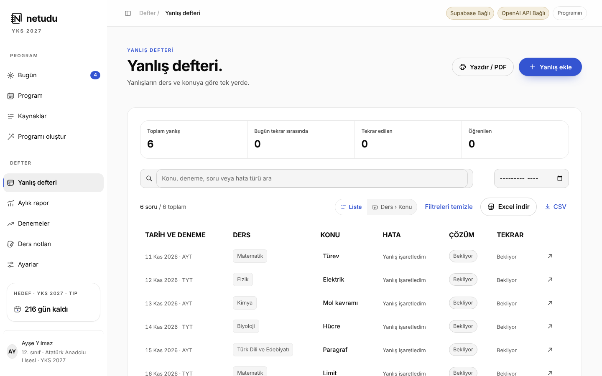
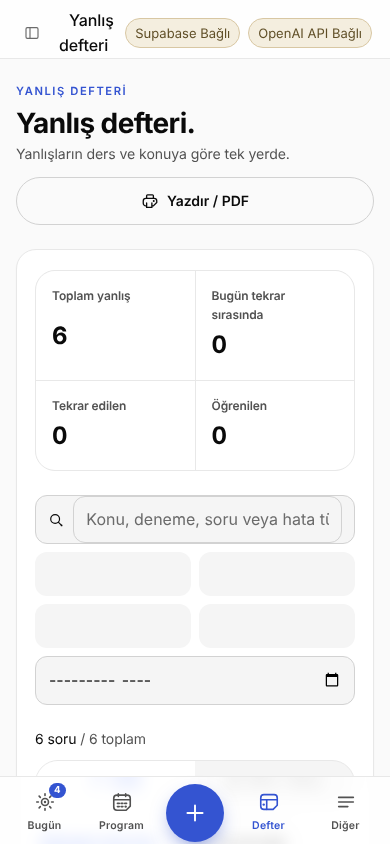
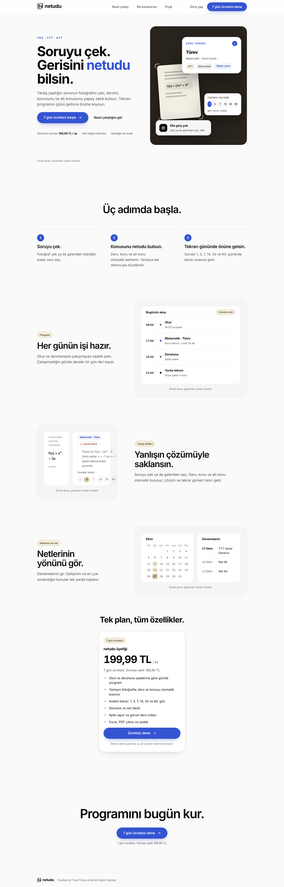
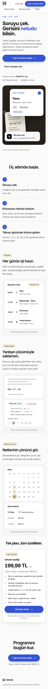
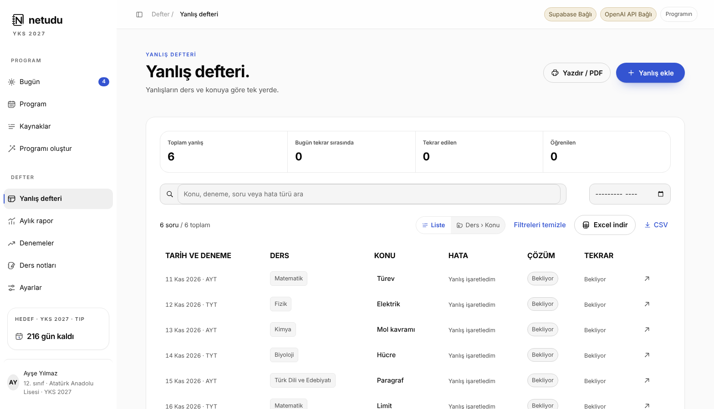
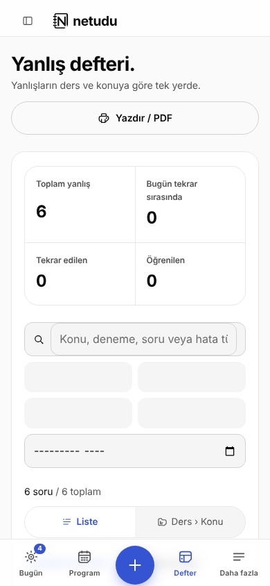
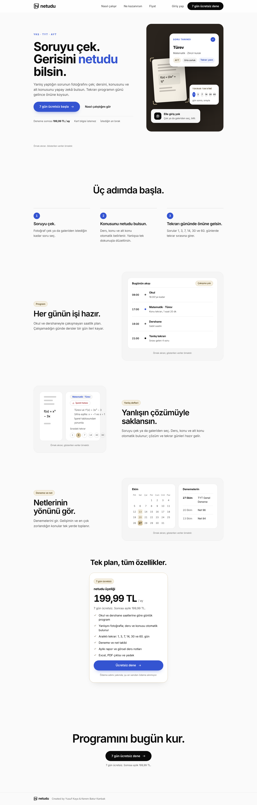
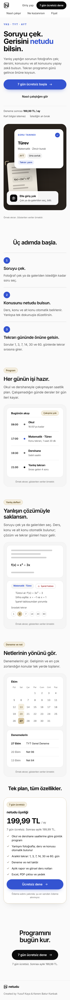
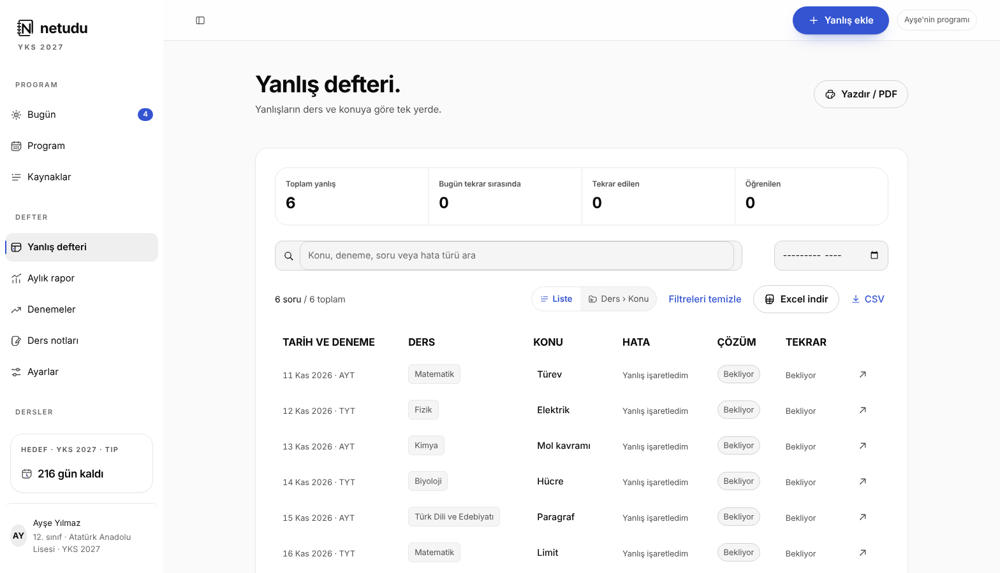

# KANIT — feat-kabuk-ve-giris

| Görev | Tür | Aralık | Tur | Yazar modeli |
|---|---|---|---|---|
| PR 3: kabuk (üst çubuk, kenar çubuğu, başlık, genişlik) + giriş sayfası | görsel / karma | feat/tasarim-sistemi (taban dal ucu)..bu turun commit'i | 1 | sonnet |

## İddia
- [x] Üst çubukta kırıntı ve sayfa başlığında büyük harfli eyebrow yok; yalnız h1 + tek satır açıklama.
- [x] `.workspace` masaüstünde kap 1120, içerik 1024 (iç boşluk 48+48), ortalı; Ayarlar `.view` düzeyinde 760px (başlıkla birlikte); Notlar iki sütunlu olduğu için geniş (1024 içerik); 1568px'te yan boşluklar eşit (96/96).
- [x] "Programı oluştur" kenar çubuğu gezinmesinde yok; program yokken Bugün boş durumunda birincil olarak zaten var.
- [x] Üst çubuk sağı: tek "Yanlış ekle" (Plus) + kullanıcı etiketi; Supabase/OpenAI durum düğmeleri kaldırıldı (Ayarlar > Geliştirici'de zaten var); başlık eylem alanında "Yanlış ekle" yok, "Programı düzenle" hayalet.
- [x] Hedef kartı ile kullanıcı satırı arası 16px; tetikleyici 44px.
- [x] Mobil alt çubuk: Bugün, Program, +(56px), Defter, Daha fazla.
- [x] Giriş sayfası: renkli gradyan yok; kahraman 560px metin sütunu + koyu panel; h1 68px/40px; üst çubuk "7 gün ücretsiz dene" siyah dolgu; kobalt yalnız kahraman ve fiyat birincilinde; 390px'te yatay kaydırma yok.

## Önce
Taban kabuğun sözcüğüne kopyası (`before-frame.tsx`) + taban CSS ile üretildi: `*-onceki.png`, `olcum-onceki.json`.
    
Koyu: `defter-1440-koyu-onceki.png`, `defter-390-koyu-onceki.png`, `landing-*-koyu-onceki.png`, `bugun-bos-*-onceki.png`; ayrıca `ayarlar-1568-acik-onceki.png`, `notlar-1568-acik-onceki.png`.

## Sonra
      
Koyu: `*-koyu-sonraki.png`; `bugun-bos-*-sonraki.png`. Ölçümler: `olcum-sonraki.json`.
Komut: `ND_ROOT=$PWD MODE=onceki|sonraki PLAYWRIGHT_BROWSERS_PATH=/opt/pw-browsers node scripts/shell-preview.mjs` (onceki için taban CSS'i gerekir: taban dalın `app/styles/` dizini; bu turda "önce" PNG'ler CSS 80-kabuk-giris.css eklenmeden önce üretildi).

## "Güncel CSS ile gerçek sorun var mıydı?" (madde madde)
| Madde | Sonuç |
|---|---|
| 1 Başlık tekrarı | VARDI: önce `crumb=true`, `.page-heading .eyebrow=true` (defter 1440 ölçümü); sonra ikisi de yok. Mobilde de kırıntı yok. |
| 2 Genişlik | VARDI: kap 1280px ve sola yaslı (1568'de 16px/16px boşluk, içerik 1184); Notlar/Ayarlar da 1184. Sonra kap 1120 / içerik 1024 ortalı (96/96), Ayarlar view 760, Notlar geniş (koordinatör kararı). |
| 3 "Programı oluştur" nav | VARDI (`navHasCreate=true`); kaldırıldı. Bugün boş durumunda (`PlanStart`) birincil buton zaten vardı, dokunulmadı. |
| 4 Durum düğmeleri | VARDI (`statusBtns=2`); kaldırıldı. Ayarlar > Geliştirici'de OpenAI (settings.tsx:253) ve Supabase (280) durumları zaten var, dokunulmadı. Başlıktaki "Yanlış ekle" (Bugün'de ikincil, diğerlerinde birincil) kaldırıldı. |
| 5 Boşluk | VARDI: 20px (12 kenar boşluğu + 8 kaptan gap); sonra 16px (ölçüm: `targetToProfileGap`). Önizlemede kenar çubuğu çerçevesi tailwind'siz taklit; gerçek `gap-2` unlayered `gap:0` kuralıyla ezilir. |
| 6 Alt çubuk | Yapı zaten istenendeydi; yalnız "Diğer" -> "Daha fazla", FAB 58 -> 56px. |
| 7 Landing | Renkli gradyan/parıltı güncel CSS'te YOKTU (kahraman/auth). Tek kalan: `.lp-plan::after` bej tarama animasyonu (kaldırıldı); beyaz buton taraması nötr, kaldı. Sorun olan: iki kobalt dolgu (üst çubuk + kahraman) ve kapanış CTA'sı. Kahraman 2 sütun/68px/40px zaten vardı; sütun 560px'e sabitlendi. |

## Test / Ölçüm
| Komut | Beklenen | Gerçek | Çıkış kodu | Sonuç |
|---|---|---|---|---|
| `ND_ZOD_PATH=/opt/npm-tools/node_modules/zod/index.js npm test` | tüm testler yeşil | tests 41, pass 41, fail 0, skipped 0 | 0 | PASS |
| `scripts/shell-preview.mjs` ölçümü (1440/390/1568) | sw==cw (yatay kaydırma yok), tetikleyici 44, boşluk 16, FAB 56, üstte tek kobalt | tümü `olcum-sonraki.json`'da; kobalt: masaüstü 1, mobil Bugün-boş 2 (birincil + FAB, bkz. kapsam dışı) | 0 | PASS (not var) |

## Tur 2 (inceleme SKOR 3 bulguları)
- [x] Ekran başına en fazla bir kobalt birincil (üst çubuk "Yanlış ekle" yalnız Defter'de birincil).
- [x] Landing h1 clamp korunuyor; 520/521px sıçraması yok; üst çubuk hedefleri 44px.
- [x] Render testi esbuild/react yoksa BAŞARISIZ; test paketi docs/proof'a bağımlı değil.

**Karar/kod:** `topbarAddVariant(view)`: yalnız `archive` -> primary, diğer tüm ekranlar secondary (Bugün'ün plan varken "Tamamla" ve plan yokken "Programı oluştur" birincili var, bu yüzden Bugün de ikincil). Kullanılmayan `sidebarNavLabels`, `'add-wrong'`, `mobileBarItems` silindi, totolojik testler düzeltildi. Ayarlar'da `.error-banner` 760px kuralına eklendi.

**Kobalt dolgu buton (#3454D1) sayımı, 1440x900 ilk ekran, geliştirici OLMAYAN kullanıcı** (`TABLE=1 node scripts/shell-preview.mjs`, `olcum-tablo.json`; Defter/Bugün/Notlar/Ayarlar/Program/Kaynaklar gerçek bileşen SSR çıktısı, recharts düz karşılık, örnek veri):
| Ekran | Plan yok | Plan var |
|---|---|---|
| Bugün | 1 (Programı oluştur) | 1 (Tamamla) |
| Program | 1 (Programı oluştur) | 5 (seçili "1. hafta" çipi + 4 "Tamamla"; bu tur öncesinden var, kapsam dışı) |
| Kaynaklar | 1 (Programı oluştur) | 1 (Soru bankası ekle; kaynak eklendikçe kaynak kartı birincilleri artar, koddan: resources.tsx:33) |
| Defter | 1 (Yanlış ekle) | 1 (Yanlış ekle) |
| Aylık rapor | 0 ilk ekranda | 0 ilk ekranda; "Notları hazırla" (report.tsx:22) katlamanın altında, koddan: 1 |
| Denemeler | 0 ilk ekranda | 0 ilk ekranda; `primary full` (exams.tsx:22) katlamanın altında, koddan: 1 |
| Ders notları | 1 (Notu hazırla) | 1 (Notu hazırla) |
| Ayarlar | 1 (Programı oluştur) | 1 (Programı düzenle); Kaydet vb. katlamanın altında, koddan: birden çok (Kaydet, OpenAI/Supabase; geliştirici bölümleri) |
Sonuç: üst çubuk "Yanlış ekle" artık hiçbir ekranda ikinci kobalt eklemiyor. İlk ekranda tek sapma Program + plan var (5, Tamamla düğmeleri; bu PR dışı, açık soru). Mobil "+" FAB değişmedi (koordinatör kararı).

**Landing h1 (önizleme, `olcum-tablo.json`)**: clamp(2.5rem,5.2vw,4.25rem) geri geldi; `.lp-hero h1{font-size:4.25rem}` ve 520px kuralı silindi.
| Genişlik | 320 | 390 | 520 | 521 | 600 | 768 | 900 | 1024 | 1440 |
|---|---|---|---|---|---|---|---|---|---|
| Boyut (px) | 40 | 40 | 40 | 40 | 40 | 40 | 46,8 | 53,2 | 68 |
| Satır | 3 | 3 | 2 | 2 | 2 | 2 | 2 | 2 | 3 |
Yatay kaydırma yok (sw==cw hepsinde). Not: 50-v10-v11.css:355'teki `max-width:360px -> 2.25rem` kuralı 70-v13.css'teki clamp tarafından zaten (bu PR'dan önce) eziliyordu; 320'de 40px kalır, dokunulmadı.

**Landing dokunma hedefleri**: `.lp-link`, `.lp-nav nav a`, `.lp-logo` `min-height:var(--h-btn);display:inline-flex;align-items:center` (+ `.lp-link{white-space:nowrap}`: önizlemede 320 ve 768'de "Giriş yap" iki satıra sarılıp 63-66px oluyordu). Ölçüm: tüm genişliklerde link 44, nav a 44, logo 44.

**Test/araç**: `tests/shell-render.test.mjs` esbuild/react-dom bulunamazsa açık hata mesajıyla (aranan yollar listesiyle) BAŞARISIZ olur; NODE_PATH, /opt/npm-tools, kök ve üst dizinlerin node_modules'u aranır (olmayan yolla denendi: 7 fail). Test girişi `scripts/preview/shell-entry.tsx` docs/proof'u içe aktarmaz; OldFrame yalnız `shell-entry-onceki.tsx` (MODE=onceki) içinde. Test paketi `ND_ZOD_PATH=... npm test`: 43/43, çıkış 0 (önce: yeni varyant testi kırmızıydı, 39/40).

**Ölü CSS**: `.crumb`, `.crumb-root`, `.topbar b`, `.topbar-end .status`, `.page-heading .eyebrow`, `.page-heading .actions .primary` SİLİNMEDİ. Gerekçe: kurallar 00/20/50 dosyalarında virgülle gruplanmış, tek satırlık minify seçici listelerinin içinde (örn. `.crumb-root,.private-label{...}`, `.topbar b,.topbar .crumb b{...}`); ayıklamak komşu canlı seçicileri riske atar ve kapsam dışı yeniden yazım gerektirir. app/ ve components/ içinde `crumb` kullanımı yalnız shadcn `breadcrumb.tsx`'te (ilgisiz). Ayrı temizlik PR'ı önerilir.

## Orkestratör doğrulaması

- `ND_ZOD_PATH=/opt/npm-tools/node_modules/zod/index.js npm test` yeniden koşuldu: 41/41, çıkış 0.
- landing-1440-acik ve defter-1440-koyu görüntüleri gözle kontrol edildi: başlık tekrarı yok, tek kobalt kahraman butonu, üst çubukta tek "Yanlış ekle".
- Gerçek Tailwind/next build bu ortamda yok; Vercel önizlemesinde teyit gerekir.

## Kapsam dışı / bilinen eksikler
- Önizleme: Next/Tailwind çalıştırılmadı; kenar çubuğu çerçevesi ve radix bileşenleri düz karşılık; yazı tipi Manrope değil; Notlar/Ayarlar/Defter içeriği gerçek bileşenlerin örnek veriyle SSR çıktısı (DERSLER öğeleri stub kaydırma kabında görünmüyor).
- Notlar iki sütunlu olduğu için 760 uygulanmadı (koordinatör kararı); 760 yalnız Ayarlar'da.
- Kural dışı (koordinatör kararı): mobil alt çubuktaki "+" FAB gezinme öğesi sayılır, kobalt kalır; Bugün (program yok) mobilde boş durumun birincili ile birlikte iki kobalt görünür.
- `.td-focus.is-done::before` (Bugün, tamamlanma) `--glow-b` radyal gradyanı kapsam dışı; kum rengiyle kalır (plan), dokunulmadı.
- Yeni testlerden `shell.test.mjs` önce kırmızı koşuldu (modül yok); `shell-render.test.mjs` ve css-split değişikliği kod sonrası eklendi (kırmızı kanıtı yok).

## Yeniden üretme
1. Bu turun commit'ini checkout et (SHA: REVIEW-<n>.md başlığı / PR head'i).
2. `ND_ZOD_PATH=/opt/npm-tools/node_modules/zod/index.js npm test`
3. `ND_ROOT=$PWD MODE=sonraki PLAYWRIGHT_BROWSERS_PATH=/opt/pw-browsers node scripts/shell-preview.mjs`

## Orkestratör doğrulaması (Tur 2)

- `ND_ZOD_PATH=/opt/npm-tools/node_modules/zod/index.js npm test` yeniden koşuldu: 43/43, çıkış 0 (yukarıdaki 41/41 Tur 1 sayısıdır).
- İnceleyici 2. turda kobalt tablosunu yeniden üretti; olcum-tablo.json ile aynı. `olcum-sonraki.json`'daki Ayarlar 0, geliştirici kullanıcıyla alınmış ölçümdür; olcum-tablo.json geliştirici olmayan kullanıcıdır.
- PR 5/6'ya kalanlar: Program ekranındaki çoklu kobalt "Tamamla"lar, Ayarlar katlama altı çoklu primary, ölü CSS temizliği.
