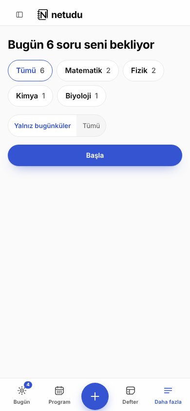
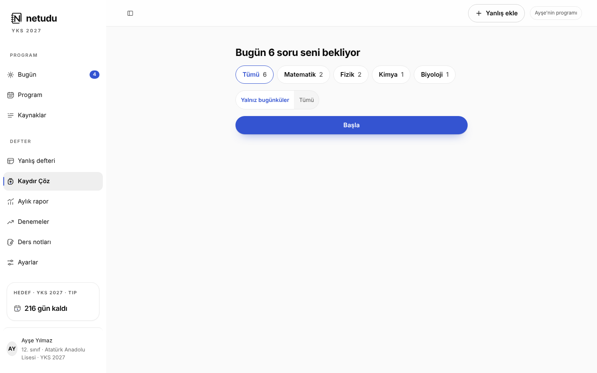
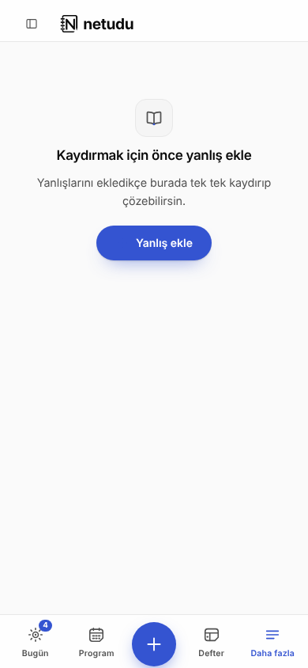
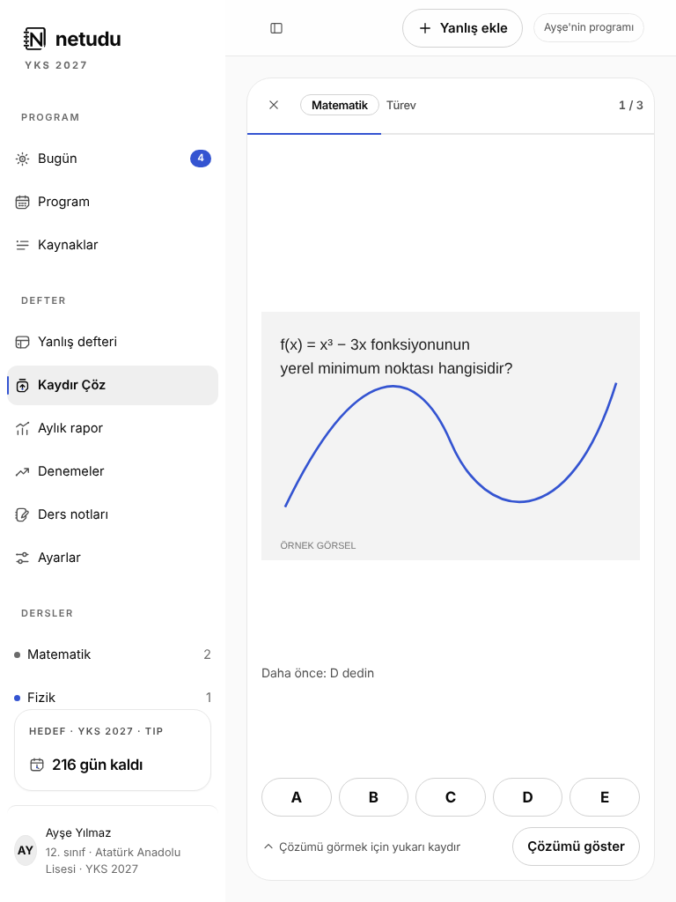
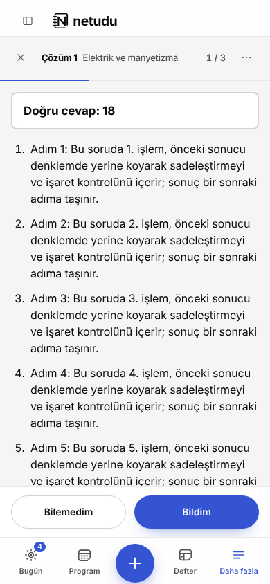
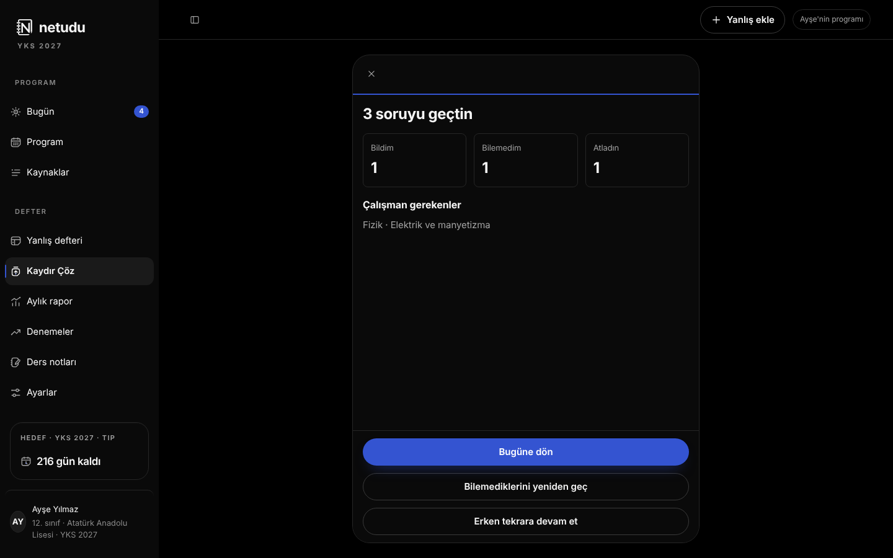

# KANIT — feat-kaydir-coz-ekran

| Görev | Tür | Aralık | Tur | Yazar modeli |
|---|---|---|---|---|
| PR K2: Kaydır Çöz ekranı (SwipeView, akış kabı, soru/çözüm/bitiş kartları, use-swipe-session, 99-kaydir-coz.css, gezinme girdisi + SwipeStack glifi, önizleme betiği) | görsel + mantık (karma) | 177a288..bu turun commit'i | 1 | sonnet |

K1 mantığı (queue.ts, answer.ts, server.ts) DEĞİŞTİRİLMEDİ; ekran onu olduğu gibi çağırır. `lib/swipe/session.ts` Tur 2'de genişledi (`settleOldSessions`, `purgeOldSessions(keepPending)`, `collectPending` tries>=3) ve Tur 3'te değişmedi. Yeni ekran olduğundan "önce" yoktur.

## İddia
- [x] Gezinme: "Kaydır Çöz" kenar çubuğunda "Yanlış defteri"nin hemen altında, `SwipeStack` glifiyle; başlık "Kaydır Çöz." + planın açıklaması; pageActions boş; üst çubuk "Yanlış ekle" ikincil. Mobil alt çubuğa girdi EKLENMEDİ (kenar menüsü "Daha fazla"da vurgulanır).
- [x] Başlangıç: "Bugün N soru seni bekliyor" (vadesi yoksa "Bugünkü tekrarların bitti. İstersen erken tekrar yap."), yalnız sorusu olan derslerin çipleri + sayı, "Yalnız bugünkü / Tümü" anahtarı, tek birincil "Başla"; yarım oturumda "Kaldığın yerden devam et (n/m)" + ikincil "Baştan başla"; tanınmayan sorular için "N soru konu bekliyor, deftere git"; boş durum "Kaydırmak için önce yanlış ekle" + "Yanlış ekle".
- [x] Akış kabı `role="feed"` + `aria-label="Kaydır Çöz soruları"`; her kart `<article>` + `aria-posinset/aria-setsize/aria-labelledby` ("Soru 4: Matematik, Türev" / "Çözüm 4"); `aria-live="polite"` bölgesi kart değişimini ve sonucu duyurur; kart değişince odak başlığa (tabIndex=-1, preventScroll).
- [x] Soru kartında cevap anahtarı METNİ yok (yalnız A–E harfleri); şık dokunuşu cevabı kilitler, çözüm kartına kaydırır ve doğru→Bildim / yanlış→Bilemedim işaretler; görünür "Çözümü göster" düğmesi; alt ipucu yalnız ilk 3 kartta; fotoğraf alt metni transkripsiyon ya da "Soru fotoğrafı, ders, konu".
- [x] Çözüm kartı: sonuç bandı ("Doğru cevap: B", şıkta "Sen: D", doğruda kobalt / yanlışta --destructive çerçeve), numaralı adımlar, kum zeminli kritik nokta, konu notu "Devamı"; uzun çözümde kart içi kayar (`.scroll-body`); çözümsüzde cevap anahtarı + ikincil "Yapay zekâyla çöz" (yalnız tıklamayla; kodda tek `.solve(` çağrısı düğmenin onClick'inde); `readable:false` → "Fotoğraf okunamadı"; sabit alt çubuk solda ikincil "Bilemedim", sağda tek birincil "Bildim"; işaretlenmişse "Sonucu değiştir" + "Sonraki"; ⋯ menüsü: Soruyu aç / Konu videosu / Öğrendim, artık gösterme.
- [x] Bitiş kartı: "N soruyu geçtin", Bildim/Bilemedim/Atladın sayıları, "Sıradaki tekrar", "Çalışman gerekenler"; tek birincil "Bugüne dön"; "Bilemediklerini yeniden geç" yalnız Bilemedim>0; "Erken tekrara devam et" / "Öğrenilenler dahil baştan" yalnız havuz doluyken.
- [x] Sonuç yazmaları arka planda gider (`PATCH {review}`), akış yanıtı beklemez; başarıda `s.upsert`; başarısız `pending`'de kalır ve sonraki kart geçişinde yeniden denenir (≤3, `duePending/afterAttempt`); `visibilitychange` + `pagehide` → `fetch(...,{keepalive:true})`; açılışta eski günlerin bekleyenleri `collectPending` ile bir kez gönderilir (her deneme `settleOldSessions` ile anahtara işlenir; bekleyeni olan anahtarlar `purgeOldSessions(…,keepPending)` ile korunur, boşalan silinir); oturum `kaydir:<kullanıcı>:<gün>` anahtarıyla `loadSession/saveSession` (try/catch K1'de).
- [x] Klavye (yalnız odak metin alanında / pencerede değilken): ↓/Boşluk/J sonraki, ↑/K önceki, A–E şık, 1 Bildim, 2 Bilemedim, Esc çık; hareket azaltılmışsa kaydırma anında ve otomatik geçiş yok; aksi hâlde işaretlemeden 400 ms sonra sonraki karta geçer.
- [x] 99-kaydir-coz.css globals.css'in en sonunda; seçiciler `.view[data-view=swipe]` altında (belgelenmiş 2 istisna: sayfa başlığını gizleyen `.workspace:has(...)` kuralları ve portaldaki fotoğraf penceresi `.sw-viewer`); düz hex yok; `.sw-feed{height:var(--sw-h);overflow-y:auto;overscroll-behavior:contain;scroll-snap-type:y mandatory}`, `.sw-card{height:100%;scroll-snap-align:start;scroll-snap-stop:always}`, `.scroll-body{overflow-y:auto}`; mobilde alt çubuk `env(safe-area-inset-bottom)`; masaüstünde kartlar ≤560px sütunda.
- [x] 110 ekran (11 ekran × 320/390/768/1100/1440 × açık/koyu): yatay taşma yok, görünür alanda tam bir kart ve kart akış kabına tam oturuyor, sayfa kaymıyor, kırılan/kırpılan düğme yok, dokunma hedefi ≥44 (şık ve alt çubuk mobilde ≥48), birincil ≤1.
- [x] Klavye akışı (taklit ağ, gerçek SwipeView + kanca): ↓ ile çözüm kartına, 1 ile sonuca, ↓ ile sonraki soruya geçilir; oturum sonunda bitiş kartı çıkar; her Bildim için bir `PATCH {"review":"doğru"}` (6/6) arka planda gider; Esc başlangıca döner; yarım oturumda "Kaldığın yerden devam et (2/7)" çıkar ve devam sonraki karta konumlanır.

## Önce
Yeni ekran; taban dalda "Kaydır Çöz" yoktur. Önce görüntüsü yok.

## Sonra
Başlangıç:   Boş durum: 
Soru:    
Çözüm:     
Bitiş:   
Tam ölçüm: `olcum-sonraki.json` (110 ekran; 320 px'ten 4 örnek görüntü: `*-320-acik-sonraki.png`); klavye akışı kaydı: `klavye.json`. Fotoğraflar örnek bir SVG ile değiştirildi ("ÖRNEK GÖRSEL"); veriler örnektir.

## Test / Ölçüm
| Komut | Beklenen | Gerçek | Çıkış kodu | Sonuç |
|---|---|---|---|---|
| `ND_ZOD_PATH=/opt/npm-tools/node_modules/zod/index.js npm test` | tümü yeşil, atlanan yok | 133 test, 133 geçti, 0 kaldı, 0 atlandı (Tur 3 sonu; `PLAYWRIGHT_BROWSERS_PATH=/opt/pw-browsers` ile) | 0 | PASS |
| `ND_ROOT=$PWD OUT=<dizin> PLAYWRIGHT_BROWSERS_PATH=/opt/pw-browsers node scripts/kaydir-preview.mjs` | 110 ekranda taşma/kırık/küçük hedef/sayfa kayması yok, birincil ≤1, tek kart oturuyor | 110/110 temiz (sorunlu 0; Tur 3 sonu yeniden üretildi) | 0 | PASS |
| Klavye akışı (aynı betik) | ↓ → çözüm, 1 → sonuç, ↓ → sonraki, sonda bitiş kartı | 390 ve 1100'de 6/6 soru, bitiş kartı göründü, 6 arka plan PATCH; otomatik geçiş (hareket azaltılmamış) 400 ms sonra sonraki karta geçti | 0 | PASS |
| Tekerlek, 390 (aynı betik) | tek kart geçişi | delta 600 → tam 1 kart; delta 100 ve 300 → geri yaslandı (0) | 0 | KISMİ (aşağıya bak) |

Ölçüm notu: kırık düğme eşiği >46 (768 altı >50), dokunma ≥44 (mobilde şık/alt çubuk ≥48); bitiş ekranında 4 düğme dikey dizilir, her biri tek satır.

## Orkestratör doğrulaması
- Tur 3 sonrası `npm test` (PLAYWRIGHT_BROWSERS_PATH=/opt/pw-browsers): 133/133, çıkış 0, atlanan yok; orkestratör bağımsız koştu.
- Ölçüm (110 ekran) yazar tarafından üretildi; bağımsız yeniden üretim inceleyicide.
- Gerçek cihaz, Radix, ekran okuyucu, gerçek ağ ve tsc doğrulanamadı (yukarıdaki liste).

## Kapsam dışı / bilinen eksikler
- K3 maddeleri yapılmadı: mobil tam ekran (immersive) kipi (kabuk üst/alt çubuğu görünür; akış yüksekliği `--sw-top/--sw-bar` ile hesaplanır: değerler artık `watchChrome` ile çalışma anında ölçülür, CSS sabitleri yalnız yedektir), Bugün düğmesi, masaüstü yan panel, çevrimdışı cilalar (yalnız "Yapay zekâyla çöz", "Konu videosu", "Öğrendim" çevrimdışıyken pasif ve "Bağlantı yok").
- Gerçek cihazda DOĞRULANAMADI: gerçek dokunmatik kaydırma/snap hissi ve hızlı fiskede tek kart; iOS adres çubuğu (`dvh`) ve kart kayması; Android pull-to-refresh (`overscroll-behavior`); uzun çözümde kart içi kaydırmanın en alta inince akışa devri (`.scroll-body` zincirlenmesi; bu turda `.scroll-body`'den `overscroll-behavior:contain` bilerek çıkarıldı, çünkü Chromium'da akışa tekerlek zincirini kesiyordu); Radix menü (⋯) ve Dialog (fotoğraf görüntüleyici: iki parmakla yakınlaştırma, odak tuzağı) gerçek çıktısı; gerçek IntersectionObserver davranışı hızlı kaydırmada (yalnız Chromium headless'ta denendi); ekran okuyucu (VoiceOver/TalkBack) duyuruları; gerçek ağ yazmaları (taklit PATCH ile denendi; `keepalive` ile sekme kapatırken gönderim, yeniden deneme ve çevrimdışı uyarısı gerçek ağda denenmedi); `tsc` (ortamda `node_modules`/`@types` yok, tip denetimi çalıştırılamadı).
- Tekerlek: headless Chromium'da küçük sentetik delta (100–300px) snap'te geri yaslanır; 600px tam bir kart ilerletti. Gerçek fare tekerleği/dokunma bu ortamda temsil edilmez.
- Önizleme Radix/shadcn yerine düz karşılıklar kullanır (ui-stubs); Manrope yüklenmez; tailwind derlenmez; ⋯ menü içeriği hidden gelir (ekran görüntülerinde menü açık çizilmez).
- Metin kontrastı 4,5:1 ayrıca ölçülmedi (mevcut jetonlar kullanıldı).
- "Konu videosu": çözümde kayıtlı video varsa ilki yeni sekmede açılır, yoksa soru penceresi (s.select) açılır; soru penceresindeki sekme seçimi dışarıdan ayarlanamadığından doğrudan "Konu videosu" sekmesi açılmaz.
- "Sonucu değiştir" yalnız Bildim↔Bilemedim arasında çevirir; kart terk edildikten sonra (ilk sonuç yazıldı) yeniden değiştirilemez (K1 kuralı: yalnız ilk sonuç yazılır).
- (Tur 2'de giderildi) Sekme gizlenirken keepalive sonuçları artık yanıt başarılı olunca bekleyenden çıkar; bkz. Tur 2, madde 2.

## Plandaki gerçek cihaz kontrol listesi (Vercel önizlemesinde işaretlenecek)
- [ ] iPhone Safari: adres çubuğu açılıp kapanırken kart kaymıyor; hızlı fiske tek kart geçiyor.
- [ ] Android Chrome: yukarıdan çekince sayfa yenilenmiyor (overscroll-behavior).
- [ ] Uzun çözümün içi kayıyor, en alta gelince akış devralıyor.
- [ ] Ekran okuyucu (VoiceOver / TalkBack) kart sırasını ve sonucu duyuruyor.
- [ ] Masaüstü fare tekerleği: tek çentik = tek kart (tekerlek için ek işleyici eklenmedi; yalnız yerel scroll-snap).
- [ ] Sekme kapatılırken bekleyen sonuç kaydediliyor (soru penceresinin Tekrar sekmesinde görünüyor).

## Yeniden üretme
1. Bu turun commit'ini checkout et (SHA: REVIEW-<n>.md başlığı / PR head'i).
2. `ND_ZOD_PATH=/opt/npm-tools/node_modules/zod/index.js npm test`
3. `ND_ROOT=$PWD OUT=<dizin> PLAYWRIGHT_BROWSERS_PATH=/opt/pw-browsers node scripts/kaydir-preview.mjs` (ONLY=<ekran adı parçası>, NOKEYS=1 klavye akışını atlar)

## Orkestratör doğrulaması (Tur 1)

- `npm test`: 117/117, çıkış 0. Ölçüm (88 ekran) yazar tarafından üretildi; bağımsız yeniden üretimi inceleyiciye bırakıldı.
- Şıkla işaretlenen sonuçta otomatik sonraki karta geçilmemesi (sapma 5): plandaki iki kural (şık→çözüm kartına kayar; işaretleyince 400 ms sonra otomatik geçer) birbiriyle çeliştiği için çözümü okuma fırsatı korunarak yazar tarafından seçildi; inceleyici değerlendirir.
- Gerçek cihaz, Radix, IntersectionObserver, ekran okuyucu ve tsc bu ortamda doğrulanamadı.

## Tur 2 (inceleme 1 bulguları; SKOR 2 → düzeltmeler)

Yeni testler önce yazıldı ve düzeltmeden ÖNCE kırmızı koştu (tests/swipe-browser.test.mjs: gerçek SwipeView + kanca, Playwright, taklit ağ; tests/swipe-session.test.mjs: saf mantık). 1b için hideSent sıfırlaması geçici kaldırılıp test yeniden kırmızıya döndürüldü, sonra geri konuldu.

| # | Bulgu | Yapılan | Test |
|---|---|---|---|
| 1 | hideFlush aynı sonucu her gizlemede yeniden gönderiyordu | `hideSent` kontrolü + yanıt beklenirken `inflight`; `hideSent` her yeni oturumda (`open`) sıfırlanır, böylece "yeniden geç" oturumunda aynı soru yazılır | `1` (gizle ×3 + pagehide → 1 PATCH; önce 3), `1b` (yeni oturumda yazma düşmez) |
| 2 | hideFlush bekleyeni yanıtsız siliyordu | Çevrimdışıyken (`navigator.onLine===false`) hiçbir şey göndermez/silmez; keepalive `fetch` yanıtı dinlenir: başarılıysa pending'den çıkar, değilse kalır (tries artar); güncel kartın gizleme yazması başarısızsa kart terk edilmişse pending'e girer | `2a` (çevrimdışı: pending kalır, bağlantı gelince gider), `2b` (keepalive başarısız: kalır + tries artar; başarılı: çıkar) |
| 3 | Yeni oturumda Feed yeniden kurulmuyordu (ilk kart atlanıyordu) | Hook `epoch` sayacı (her `open`'da artar); `<Feed key={w.epoch}>` | `3` ("Bilemediklerini yeniden geç": history=1, atlandı sayılmadı; önce history=2) |
| 4 | Eski gün kısmi başarısızlığı | `settleOldSessions` (lib/swipe/session.ts): her deneme sonucu anında anahtara işlenir; gidenler çıkar, başarısızlar kalır ve tries+1; boşalan anahtar silinir; `purgeOldSessions(…,keepPending)` bekleyeni olanı korur | `settleOldSessions`, `purgeOldSessions` (saf), `4+9` (tarayıcı) |
| 5 | 320 px'te sabit `--sw-bar/--sw-top` tutmuyordu | `chrome-vars.ts` `watchChrome`: `.topbar`/`.mobile-bar` yüksekliğini ResizeObserver + resize ile ölçüp `.workspace`'e yazar, unmount'ta temizler; CSS sabitleri yedek. Önizlemeye 320×640 eklendi; statik ekranlarda aynı gerçek kod (`kaydir-chrome.ts` paketi) çalıştırılır | `5` (70px/80px ölçülür, alt çubuk 96px olunca izlenir; önce boş) ; önizleme ölçümü |
| 6 | Gerçek cihaz kutuları [x] idi | Hepsi [ ] yapıldı | - |
| 7 | instant için `'auto'` (CSS smooth ezerdi) | `behavior:'instant'` | `7` (hareket azaltma kapalı; devamda iki kare sonra konum hedefte; önce top=2) |
| 8 | `.workspace` üzerindeki `var(--sw-bar)` tanımsızdı | `--sw-top/--sw-bar` `.workspace:has(.view[data-view=swipe])` üzerine taşındı (`.view` miras alır) | `5` (değişkenler `.workspace`'te okunur), mevcut CSS testleri |
| 9 | tries>=3 kayıtlar gün değişiminde silinirdi | `collectPending` tries>=3'ü de toplar; açılışta bir kez denenir (başarısızsa tries artar) | `collectPending` (güncellendi), `4+9` (q2 tries=3 gönderildi) |
| 10 | `.scroll-body` en alttayken ↓/Boşluk akışa geçmiyordu | Odak `.scroll-body` içindeyken ve en alttayken ↓ / Boşluk (düğme üstünde değilken) `goTo(active+1)` | `10` (↓ ve Boşluk: ortada kart değişmez, en altta sonraki kart). DÜRÜST NOT: bu test düzeltmeden önce de yeşildi (Chromium'un yerel zincirleme+snap davranışı); açık işleyici tarayıcıdan bağımsız davranış için eklendi |
| 11 | Kapsam düğmesi metni | "Yalnız bugünküler" | `swipe-render` (/Yalnız bugünküler/; önce kırmızı) |

### Ölçümler (Tur 2)
- `ND_ZOD_PATH=/opt/npm-tools/node_modules/zod/index.js npm test`: 126/126 geçti, 0 kırmızı, çıkış 0.
- `node scripts/kaydir-preview.mjs`: ekran sayısı 110 (11 ekran × 5 boyut [320, 390, 768, 1100, 1440] × açık/koyu), sorunlu 0. 320'de 22 ekranın hepsinde görüntü alanı alt=0, üst=0, taşma/kırık düğme/kırpılma yok (önceki turda 18/22 ekranda alt=-14).
- Klavye akışı (kısayol-390/1100, otomatik-geçiş-390, tekerlek, devam) tekrar koştu; 6 soru 6 PATCH (tekrar yok).

### Tur 2 sınırları
- `keepalive` yanıtı/pagehide gerçek ağda ve gerçek sayfa kapanışında denenmedi; taklit ağda `visibilitychange`/`pagehide` olayları elle tetiklendi, çevrimdışılık `context.setOffline` ile.
- Gerçek cihaz kutuları (madde 6) hâlâ doğrulanmadı; orkestratör/kullanıcı işaretler.

## Tur 3 (inceleme 2 bulguları; SKOR 3 → düzeltmeler)

Her davranış için test önce yazıldı ve düzeltmeden ÖNCE kırmızı koştu (7 başarısız / 9 geçti; tests/swipe-browser.test.mjs 11–16). Test 16 ilk koşuda yanlış öğeyi (kart içi `role=status`) okuduğu için yeniden hedeflendi.

| # | Bulgu | Yapılan | Test |
|---|---|---|---|
| 1 | Gizlemede gönderilen güncel kart yavaş başarısız olunca (kart terk edildikten sonra) `hideSent` kalıyor, sonraki `leave()` kaydı siliyordu | Başarısız dalda her zaman `hideSent.delete(id)`; kart hâlâ güncel ve sonucu işlenmemişse (`current===id && !results[id].first`) bir şey eklenmez (leave ekler), aksi hâlde (terk edildi ya da oturum değişti) `addPending` | `11` (q0 PATCH 1500 ms sonra 500; gizle, ↓, 1,8 sn sonra pending=[q0]; sonraki geçişte yeniden gönderilir ve pending'de kalır) |
| 2 | Esc işaretsiz güncel kartı "atlandı" sayıp kuyruğa atıyordu | `exit`: işaretsiz güncel kartta oturum olduğu gibi kalır (atlandı yok), devam aynı karttan sürer; işaretliyse sonuç işlenir ve sonraki karta geçilir. `saved` kuyruk ya da güncel kart varsa tutulur. Sayaç güncel kartı 1 tabanlı gösterir (history zaten güncel kartı içerir) | `12` (Başla, Esc, devam, Esc, devam: aynı kart, skips 0, sayaç (1/toplam)), `12b` (işaretli Esc sonucu işler, sonraki kart güncel) |
| 3 | Bitiş kartında odak/duyuru yoktu | Feed odak/duyuru efektine `hasCurrent` bağımlılığı | `13` (odak `sw-end-h`, canlı bölge "Oturum bitti.") |
| 4 | `open` canlı bölgeyi sıfırlamıyordu | `open` içinde `setLive('')` | `14` |
| 5 | `loaded` kanca örneğine bağlıydı; görünümden çıkıp dönünce eski gün kayıtları iki kez gidebilirdi | Modül düzeyi `oldSending` (kullanıcı başına, gönderim sürerken yeniden başlatmaz) | `15` (`__unmount`/`__mount`; q0 yavaş yanıt, tek PATCH) |
| 6 | Gizlemede gönderilen sonuç sonradan "Sonucu değiştir" ile yerelde değişebilir | Hook `sentFirst(id)`; `mark` duyurusu ve çözüm kartı notu bu durumda "Bu oturumdaki ilk sonucun geçerli." der | `16` (canlı bölge ve görünür `.sw-result`) |
| 7 | Tekerlek | Yeni işleyici EKLENMEDİ; gerçek cihaz listesine "masaüstü fare: tek çentik = tek kart" [ ] eklendi; Test/Ölçüm tablosundaki tekerlek KISMİ notu korundu | - |
| 8 | PROOF tutarlılığı | Satır 7, 16, 19, 35–36, 46 ve "devam (2/7)" düzeltildi; ölçüm 110 ekranla yenilendi | - |

Not (madde 6, kalan sınır): gizlemede sunucuya giden sonuç, kullanıcı sonradan işareti değiştirse bile sunucuda ilk sonuç olarak kalır (K1 kuralı: oturumdaki ilk sonuç); yerel durum değişebilir, kullanıcıya bu bildirilir ama yerel sonuç ile sunucu uyuşmayabilir.

### Ölçümler (Tur 3)
- `PLAYWRIGHT_BROWSERS_PATH=/opt/pw-browsers ND_ZOD_PATH=/opt/npm-tools/node_modules/zod/index.js npm test`: 133 test, 133 geçti, 0 kaldı, 0 atlandı, çıkış 0.
- `ND_ROOT=$PWD OUT=<dizin> node scripts/kaydir-preview.mjs`: ekran sayısı 110, sorunlu 0, çıkış 0. `olcum-sonraki.json` (110 ekran), `klavye.json` ve görüntüler yeniden üretildi; 320 px'ten dört örnek eklendi. Klavye akışı: 390 ve 1100'de 6 soru 6 PATCH.

### Tur 3 sınırları
- Gizleme anında uçuşta olan keepalive isteği sayfa kapanışında yanıtsız kalırsa kayıt yalnız sunucuya gitmişse sayılır; gerçek ağda denenmedi.
- Esc ile işaretli karttan çıkışta bir sonraki kart henüz görülmeden "güncel" olur (history'ye girer); devamda o karttan sürer.
