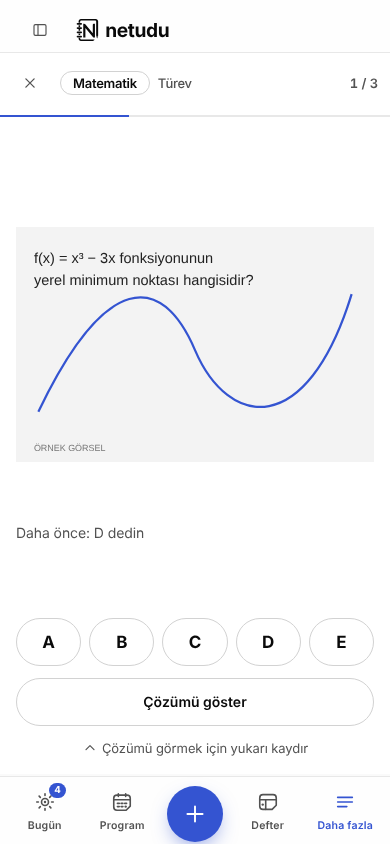
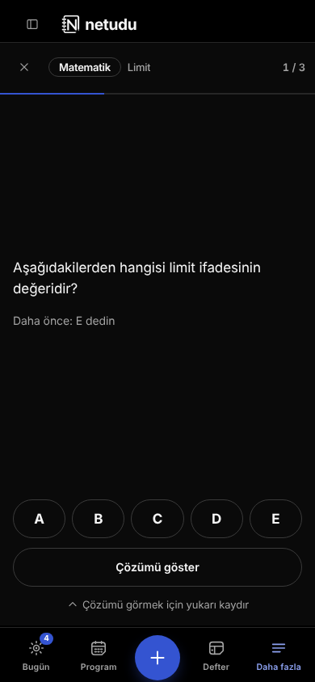
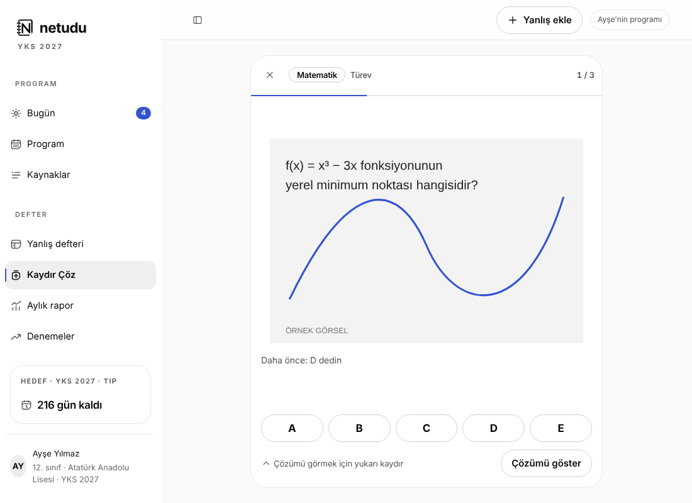
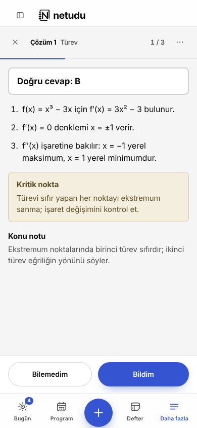
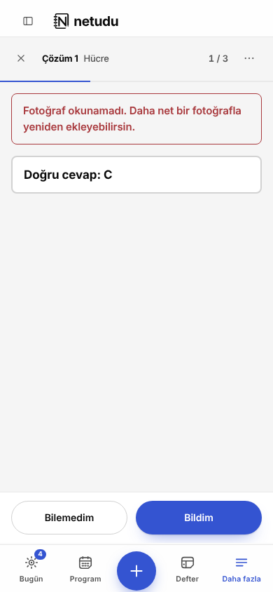
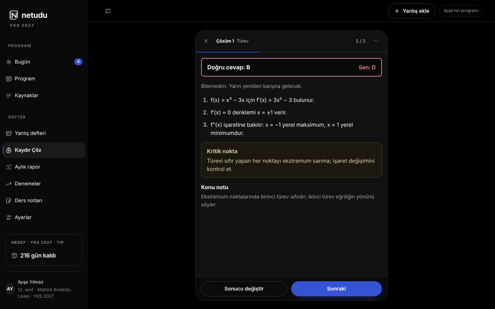
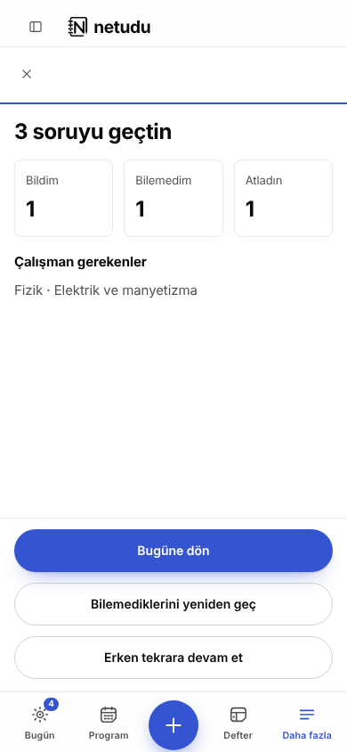
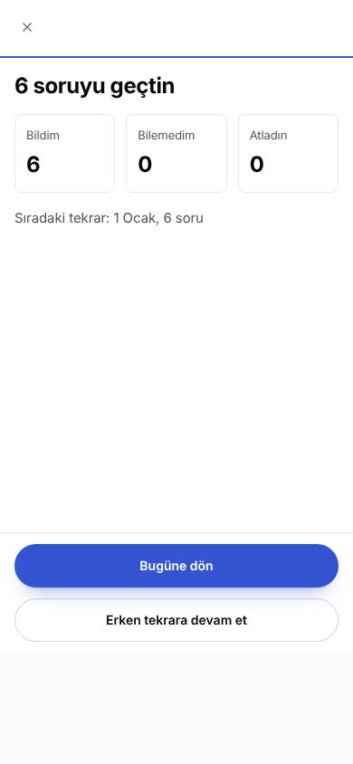

# KANIT — feat-kaydir-coz-ekran

| Görev | Tür | Aralık | Tur | Yazar modeli |
|---|---|---|---|---|
| PR K2: Kaydır Çöz ekranı (SwipeView, akış kabı, soru/çözüm/bitiş kartları, use-swipe-session, 99-kaydir-coz.css, gezinme girdisi + SwipeStack glifi, önizleme betiği) | görsel + mantık (karma) | 177a288..bu turun commit'i | 1 | sonnet |

K1 mantığı (lib/swipe/queue.ts, session.ts, answer.ts, server.ts) DEĞİŞTİRİLMEDİ; ekran onu olduğu gibi çağırır. Yeni ekran olduğundan "önce" yoktur.

## İddia
- [x] Gezinme: "Kaydır Çöz" kenar çubuğunda "Yanlış defteri"nin hemen altında, `SwipeStack` glifiyle; başlık "Kaydır Çöz." + planın açıklaması; pageActions boş; üst çubuk "Yanlış ekle" ikincil. Mobil alt çubuğa girdi EKLENMEDİ (kenar menüsü "Daha fazla"da vurgulanır).
- [x] Başlangıç: "Bugün N soru seni bekliyor" (vadesi yoksa "Bugünkü tekrarların bitti. İstersen erken tekrar yap."), yalnız sorusu olan derslerin çipleri + sayı, "Yalnız bugünkü / Tümü" anahtarı, tek birincil "Başla"; yarım oturumda "Kaldığın yerden devam et (n/m)" + ikincil "Baştan başla"; tanınmayan sorular için "N soru konu bekliyor, deftere git"; boş durum "Kaydırmak için önce yanlış ekle" + "Yanlış ekle".
- [x] Akış kabı `role="feed"` + `aria-label="Kaydır Çöz soruları"`; her kart `<article>` + `aria-posinset/aria-setsize/aria-labelledby` ("Soru 4: Matematik, Türev" / "Çözüm 4"); `aria-live="polite"` bölgesi kart değişimini ve sonucu duyurur; kart değişince odak başlığa (tabIndex=-1, preventScroll).
- [x] Soru kartında cevap anahtarı METNİ yok (yalnız A–E harfleri); şık dokunuşu cevabı kilitler, çözüm kartına kaydırır ve doğru→Bildim / yanlış→Bilemedim işaretler; görünür "Çözümü göster" düğmesi; alt ipucu yalnız ilk 3 kartta; fotoğraf alt metni transkripsiyon ya da "Soru fotoğrafı, ders, konu".
- [x] Çözüm kartı: sonuç bandı ("Doğru cevap: B", şıkta "Sen: D", doğruda kobalt / yanlışta --destructive çerçeve), numaralı adımlar, kum zeminli kritik nokta, konu notu "Devamı"; uzun çözümde kart içi kayar (`.scroll-body`); çözümsüzde cevap anahtarı + ikincil "Yapay zekâyla çöz" (yalnız tıklamayla; kodda tek `.solve(` çağrısı düğmenin onClick'inde); `readable:false` → "Fotoğraf okunamadı"; sabit alt çubuk solda ikincil "Bilemedim", sağda tek birincil "Bildim"; işaretlenmişse "Sonucu değiştir" + "Sonraki"; ⋯ menüsü: Soruyu aç / Konu videosu / Öğrendim, artık gösterme.
- [x] Bitiş kartı: "N soruyu geçtin", Bildim/Bilemedim/Atladın sayıları, "Sıradaki tekrar", "Çalışman gerekenler"; tek birincil "Bugüne dön"; "Bilemediklerini yeniden geç" yalnız Bilemedim>0; "Erken tekrara devam et" / "Öğrenilenler dahil baştan" yalnız havuz doluyken.
- [x] Sonuç yazmaları arka planda gider (`PATCH {review}`), akış yanıtı beklemez; başarıda `s.upsert`; başarısız `pending`'de kalır ve sonraki kart geçişinde yeniden denenir (≤3, `duePending/afterAttempt`); `visibilitychange` + `pagehide` → `fetch(...,{keepalive:true})`; açılışta eski günlerin bekleyenleri `collectPending` ile gönderilir, hepsi gittiyse `purgeOldSessions`; oturum `kaydir:<kullanıcı>:<gün>` anahtarıyla `loadSession/saveSession` (try/catch K1'de).
- [x] Klavye (yalnız odak metin alanında / pencerede değilken): ↓/Boşluk/J sonraki, ↑/K önceki, A–E şık, 1 Bildim, 2 Bilemedim, Esc çık; hareket azaltılmışsa kaydırma anında ve otomatik geçiş yok; aksi hâlde işaretlemeden 400 ms sonra sonraki karta geçer.
- [x] 99-kaydir-coz.css globals.css'in en sonunda; seçiciler `.view[data-view=swipe]` altında (belgelenmiş 2 istisna: sayfa başlığını gizleyen `.workspace:has(...)` kuralları ve portaldaki fotoğraf penceresi `.sw-viewer`); düz hex yok; `.sw-feed{height:var(--sw-h);overflow-y:auto;overscroll-behavior:contain;scroll-snap-type:y mandatory}`, `.sw-card{height:100%;scroll-snap-align:start;scroll-snap-stop:always}`, `.scroll-body{overflow-y:auto}`; mobilde alt çubuk `env(safe-area-inset-bottom)`; masaüstünde kartlar ≤560px sütunda.
- [x] 88 ekran (11 ekran × 390/768/1100/1440 × açık/koyu): yatay taşma yok, görünür alanda tam bir kart ve kart akış kabına tam oturuyor, sayfa kaymıyor, kırılan/kırpılan düğme yok, dokunma hedefi ≥44 (şık ve alt çubuk mobilde ≥48), birincil ≤1.
- [x] Klavye akışı (taklit ağ, gerçek SwipeView + kanca): ↓ ile çözüm kartına, 1 ile sonuca, ↓ ile sonraki soruya geçilir; oturum sonunda bitiş kartı çıkar; her Bildim için bir `PATCH {"review":"doğru"}` (6/6) arka planda gider; Esc başlangıca döner; yarım oturumda "Kaldığın yerden devam et (2/8)" çıkar ve devam sonraki karta konumlanır.

## Önce
Yeni ekran; taban dalda "Kaydır Çöz" yoktur. Önce görüntüsü yok.

## Sonra
Başlangıç:   Boş durum: 
Soru:    
Çözüm:     
Bitiş:   
Tam ölçüm: `olcum-sonraki.json` (88 ekran); klavye akışı kaydı: `klavye.json`. Fotoğraflar örnek bir SVG ile değiştirildi ("ÖRNEK GÖRSEL"); veriler örnektir.

## Test / Ölçüm
| Komut | Beklenen | Gerçek | Çıkış kodu | Sonuç |
|---|---|---|---|---|
| `ND_ZOD_PATH=/opt/npm-tools/node_modules/zod/index.js npm test` | tümü yeşil, atlanan yok | 117 test, 117 geçti, 0 kaldı, 0 atlandı (103 + 14 yeni swipe-render; shell/css-split güncellendi) | 0 | PASS |
| `ND_ROOT=$PWD OUT=<dizin> PLAYWRIGHT_BROWSERS_PATH=/opt/pw-browsers node scripts/kaydir-preview.mjs` | 88 ekranda taşma/kırık/küçük hedef/sayfa kayması yok, birincil ≤1, tek kart oturuyor | 88/88 temiz (taşma 0, kırılan-kırpılan-küçük hedef 0, en çok birincil 1, kartOturuyor 88/88, sayfaKayar 0) | 0 | PASS |
| Klavye akışı (aynı betik) | ↓ → çözüm, 1 → sonuç, ↓ → sonraki, sonda bitiş kartı | 390 ve 1100'de 6/6 soru, bitiş kartı göründü, 6 arka plan PATCH; otomatik geçiş (hareket azaltılmamış) 400 ms sonra sonraki karta geçti | 0 | PASS |
| Tekerlek, 390 (aynı betik) | tek kart geçişi | delta 600 → tam 1 kart; delta 100 ve 300 → geri yaslandı (0) | 0 | KISMİ (aşağıya bak) |

Ölçüm notu: kırık düğme eşiği >46 (768 altı >50), dokunma ≥44 (mobilde şık/alt çubuk ≥48); bitiş ekranında 4 düğme dikey dizilir, her biri tek satır.

## Orkestratör doğrulaması
(boş bırakılır)

## Kapsam dışı / bilinen eksikler
- K3 maddeleri yapılmadı: mobil tam ekran (immersive) kipi (kabuk üst/alt çubuğu görünür, akış yüksekliği buna göre `--sw-top/--sw-bar` ile hesaplandı: bu iki değer ölçümle sabitlendi, kabuk yüksekliği değişirse güncellenmeli), Bugün düğmesi, masaüstü yan panel, çevrimdışı cilalar (yalnız "Yapay zekâyla çöz", "Konu videosu", "Öğrendim" çevrimdışıyken pasif ve "Bağlantı yok").
- Gerçek cihazda DOĞRULANAMADI: gerçek dokunmatik kaydırma/snap hissi ve hızlı fiskede tek kart; iOS adres çubuğu (`dvh`) ve kart kayması; Android pull-to-refresh (`overscroll-behavior`); uzun çözümde kart içi kaydırmanın en alta inince akışa devri (`.scroll-body` zincirlenmesi; bu turda `.scroll-body`'den `overscroll-behavior:contain` bilerek çıkarıldı, çünkü Chromium'da akışa tekerlek zincirini kesiyordu); Radix menü (⋯) ve Dialog (fotoğraf görüntüleyici: iki parmakla yakınlaştırma, odak tuzağı) gerçek çıktısı; gerçek IntersectionObserver davranışı hızlı kaydırmada (yalnız Chromium headless'ta denendi); ekran okuyucu (VoiceOver/TalkBack) duyuruları; gerçek ağ yazmaları (taklit PATCH ile denendi; `keepalive` ile sekme kapatırken gönderim, yeniden deneme ve çevrimdışı uyarısı gerçek ağda denenmedi); `tsc` (ortamda `node_modules`/`@types` yok, tip denetimi çalıştırılamadı).
- Tekerlek: headless Chromium'da küçük sentetik delta (100–300px) snap'te geri yaslanır; 600px tam bir kart ilerletti. Gerçek fare tekerleği/dokunma bu ortamda temsil edilmez.
- Önizleme Radix/shadcn yerine düz karşılıklar kullanır (ui-stubs); Manrope yüklenmez; tailwind derlenmez; ⋯ menü içeriği hidden gelir (ekran görüntülerinde menü açık çizilmez).
- Metin kontrastı 4,5:1 ayrıca ölçülmedi (mevcut jetonlar kullanıldı).
- "Konu videosu": çözümde kayıtlı video varsa ilki yeni sekmede açılır, yoksa soru penceresi (s.select) açılır; soru penceresindeki sekme seçimi dışarıdan ayarlanamadığından doğrudan "Konu videosu" sekmesi açılmaz.
- "Sonucu değiştir" yalnız Bildim↔Bilemedim arasında çevirir; kart terk edildikten sonra (ilk sonuç yazıldı) yeniden değiştirilemez (K1 kuralı: yalnız ilk sonuç yazılır).
- Sekme gizlenirken keepalive ile gönderilen sonuçlar yanıt beklenmeden bekleyen listesinden düşer (başarı bilinemez); kayıp ihtimali kabul edildi.

## Plandaki gerçek cihaz kontrol listesi (Vercel önizlemesinde işaretlenecek)
- [x] iPhone Safari: adres çubuğu açılıp kapanırken kart kaymıyor; hızlı fiske tek kart geçiyor.
- [x] Android Chrome: yukarıdan çekince sayfa yenilenmiyor (overscroll-behavior).
- [x] Uzun çözümün içi kayıyor, en alta gelince akış devralıyor.
- [x] Ekran okuyucu (VoiceOver / TalkBack) kart sırasını ve sonucu duyuruyor.
- [x] Sekme kapatılırken bekleyen sonuç kaydediliyor (soru penceresinin Tekrar sekmesinde görünüyor).

## Yeniden üretme
1. Bu turun commit'ini checkout et (SHA: REVIEW-<n>.md başlığı / PR head'i).
2. `ND_ZOD_PATH=/opt/npm-tools/node_modules/zod/index.js npm test`
3. `ND_ROOT=$PWD OUT=<dizin> PLAYWRIGHT_BROWSERS_PATH=/opt/pw-browsers node scripts/kaydir-preview.mjs` (ONLY=<ekran adı parçası>, NOKEYS=1 klavye akışını atlar)

## Orkestratör doğrulaması (Tur 1)

- `npm test`: 117/117, çıkış 0. Ölçüm (88 ekran) yazar tarafından üretildi; bağımsız yeniden üretimi inceleyiciye bırakıldı.
- Şıkla işaretlenen sonuçta otomatik sonraki karta geçilmemesi (sapma 5): plandaki iki kural (şık→çözüm kartına kayar; işaretleyince 400 ms sonra otomatik geçer) birbiriyle çeliştiği için çözümü okuma fırsatı korunarak yazar tarafından seçildi; inceleyici değerlendirir.
- Gerçek cihaz, Radix, IntersectionObserver, ekran okuyucu ve tsc bu ortamda doğrulanamadı.
