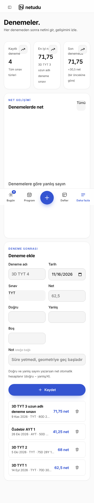
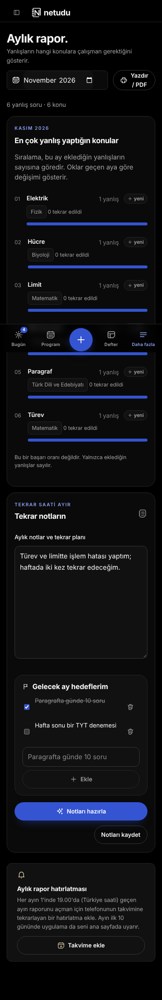
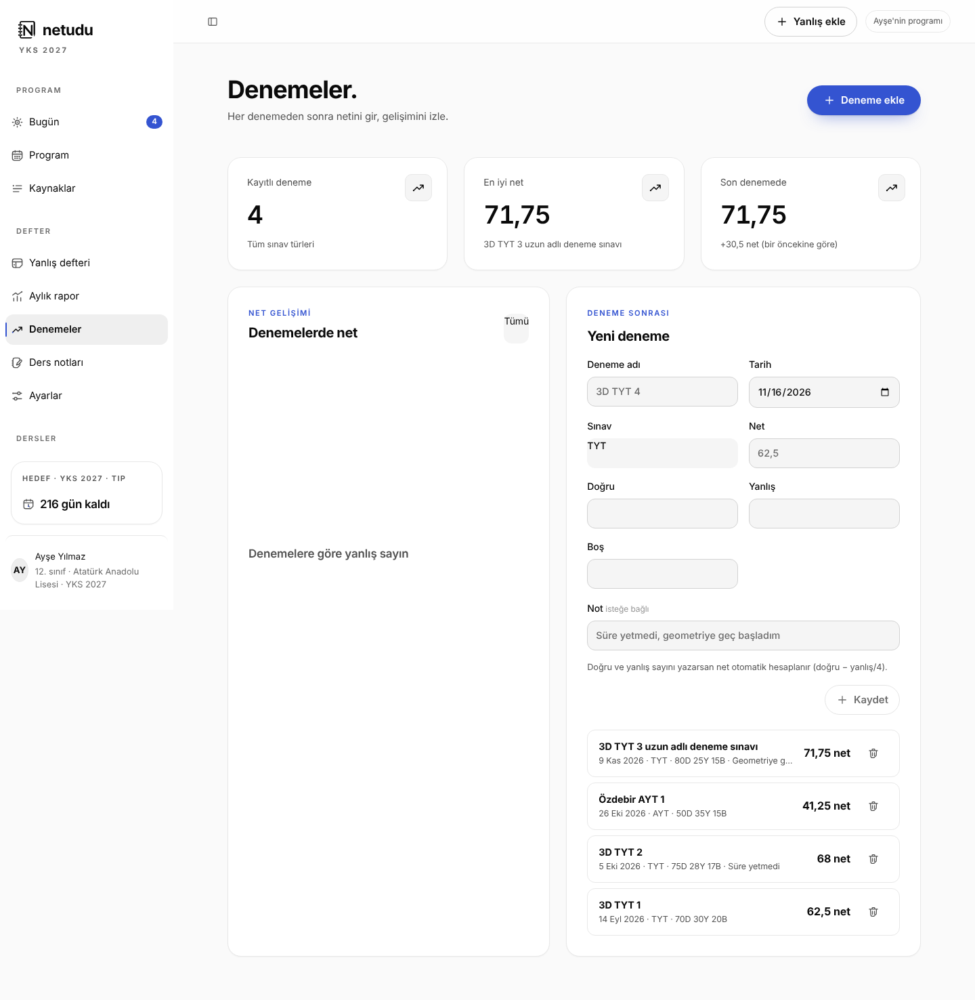
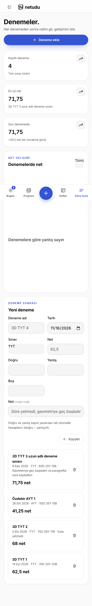
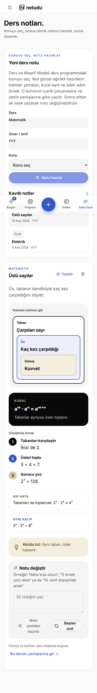
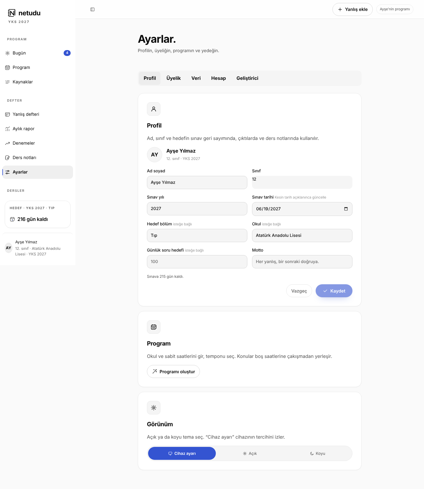
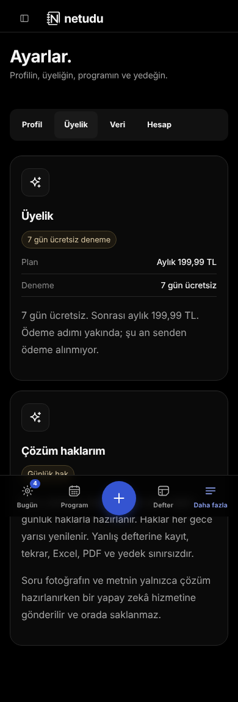
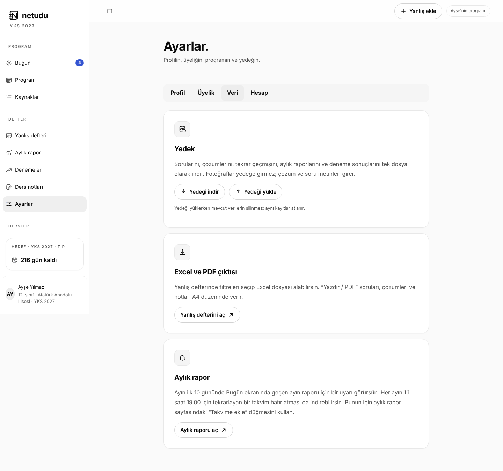
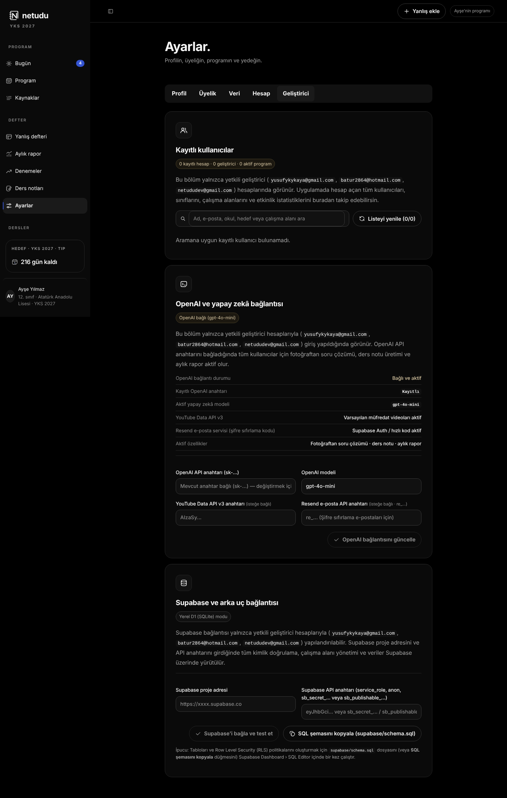

# KANIT — feat-rapor-not-ayarlar

| Görev | Tür | Aralık | Tur | Yazar modeli |
|---|---|---|---|---|
| PR 6: Aylık rapor, Denemeler, Ders notları, Ayarlar (sekmeli), .env.example | görsel + mantık (karma) | 0841c99..bu turun commit'i | 1 | sonnet |

## İddia
- [x] Aylık rapor: ay seçici sayfa başlığının sağında, "Yazdır / PDF"in solunda ikincil; gövdede tek birincil ("Notları hazırla").
- [x] Denemeler: tek birincil "Deneme ekle" başlığın sağında (mobilde de görünür); form "Kaydet" ikincil ve ad+net boşken pasif; liste mobilde kart; özet kartları 390'da alt alta.
- [x] Grafikler: çizgi kobalt (`var(--brand)`), çubuk nötr gri (`var(--fg3)`); sabit renk kodu yok. Rapor sıralama çubukları kobalt.
- [x] Ders notları: not okuma genişliği ≤760px; alttaki iki eylem ("Notu yeniden hazırla", "Baştan üret") eşit genişlikte (254+254px @1440); görsel not planın tanımıyla uyumlu.
- [x] Ayarlar: 5 sekme (Profil, Üyelik, Veri, Hesap, yalnız geliştiricide Geliştirici); 13 bölüm planın dağılımıyla; başlıklar cümle düzeninde, "&"/"Developer" yok.
- [x] Seçili sekme `useState` + `resolveTab` ile türetilir (effect yok); geliştirici olmayan hesapta "developer" seçimi Profil'e düşer.
- [x] Kaydet bölümün sağ altında; Profil'de yalnız değişiklik varken etkin (`isProfileDirty`), geliştirici formlarında yalnız anahtar girilince etkin.
- [x] Ayar ekranlarında en çok 1 birincil (önce Profil sekmesinde 2-4 idi); Profil dışı sekmelerde 0.
- [x] 60 ekran görüntüsü (1440/390 x açık/koyu): yatay taşma yok (sw==cw), kırpılan düğme yok, dokunma hedefi ≥44px, birincil ≤1.
- [x] .env.example koddaki değişkenleri açıklamalı listeler (gizli değer yok).

## Önce
Taban 0841c99 (feat/program-ve-kaynaklar) geçici --detach worktree'sinden, aynı betikle: `rapor-1440-acik-onceki.png`, `denemeler-390-acik-onceki.png`, `ayarlar-profile-gelistirici-1440-acik-onceki.png`, `ayarlar-profile-normal-390-acik-onceki.png`.
Ölçüm (önceki, logdan): Ayarlar/Profil geliştirici hesabı birincil sayısı 4, normal hesap 2 ("Programı oluştur", "Kaydet"); 14 bölüm tek sayfada. Rapor/Denemeler 1 birincil, ancak ay seçici gövdede, Denemeler'de "Kaydet" birincil tam genişlik. Not: "önceki" Notlar görüntüsünde seçili not yoktur (eski bileşen `initialSelected` almaz), bu yüzden Notlar için önce/sonra kıyası yok.
  

## Sonra
            
Tam ölçüm: `olcum-sonraki.json` (60 ekran: rapor, rapor-bos, denemeler, denemeler-bos, notlar, notlar-bos, ayarlar x 5 sekme x (normal|geliştirici), 1440/390, açık/koyu).

## Test / Ölçüm
| Komut | Beklenen | Gerçek | Çıkış kodu | Sonuç |
|---|---|---|---|---|
| `ND_ZOD_PATH=/opt/npm-tools/node_modules/zod/index.js npm test` | tümü yeşil, atlanan yok | 99 test, 99 geçti, 0 kaldı, 0 atlandı (85 + 14 yeni) | 0 | PASS |
| `node scripts/rapor-preview.mjs` (MODE=sonraki) | 60 ekranda sw==cw, kırpılan/küçük hedef yok, birincil ≤1 | 60/60 temiz | 0 | PASS |

## Orkestratör doğrulaması
- Test komutu tekrar çalıştırıldı:
- `git diff --stat` kapsam kontrolü:
- Aralık/Yeniden üretme:
- Görseller:
- Süreç/port temizliği:

## Kapsam dışı / bilinen eksikler
- Radix Tabs/menüleri gerçek tarayıcıda doğrulanamadı; önizleme düz karşılık kullanır (ui-stubs). Sekme tıklaması, klavye gezinmesi, odak halkası ve `[role=tab]` stilinin Radix çıktısında tutması Vercel önizlemesinde teyit edilmeli.
- recharts önizlemede düz kutu: çizgi/çubuk renkleri yalnız kaynak testiyle doğrulandı, gerçek çizim görülmedi.
- Plandaki "Benzer 3 soru çöz" / "Yanlış soruma dön" eylemleri kodda yok (uydurulmadı); eşit genişlik mevcut iki eyleme ("Notu yeniden hazırla", "Baştan üret") uygulandı; ikisi de ikincil (ekranda tek birincil sol paneldeki "Notu hazırla").
- Denemeler'de gerçek bir tablo yok (liste); masaüstünde satır, mobilde kart olarak düzenlendi.
- Gerçek veri akışı (kaydetme çağrıları, /api yanıtları) SSR önizlemede çalışmaz; yalnız kod okuma + dokunulmadığı için değişmedi iddiası.
- Metin kontrastı 4,5:1 bu turda ölçülmedi (mevcut jetonlar kullanıldı).
- Tip denetimi (tsc) çalıştırılmadı (PR 7).

## Yeniden üretme
1. Bu turun commit'ini checkout et.
2. `ND_ZOD_PATH=/opt/npm-tools/node_modules/zod/index.js npm test`
3. `ND_ROOT=$PWD SRC_ROOT=$PWD MODE=sonraki OUT=<dizin> PLAYWRIGHT_BROWSERS_PATH=/opt/pw-browsers node scripts/rapor-preview.mjs`

## Orkestratör doğrulaması (Tur 1)

- `ND_ZOD_PATH=/opt/npm-tools/node_modules/zod/index.js npm test` yeniden koşuldu: 99/99, çıkış 0.
- Radix sekmeleri/menüleri, recharts ve `tsc` bu ortamda doğrulanamadı; Vercel önizlemesinde teyit gerekir.
