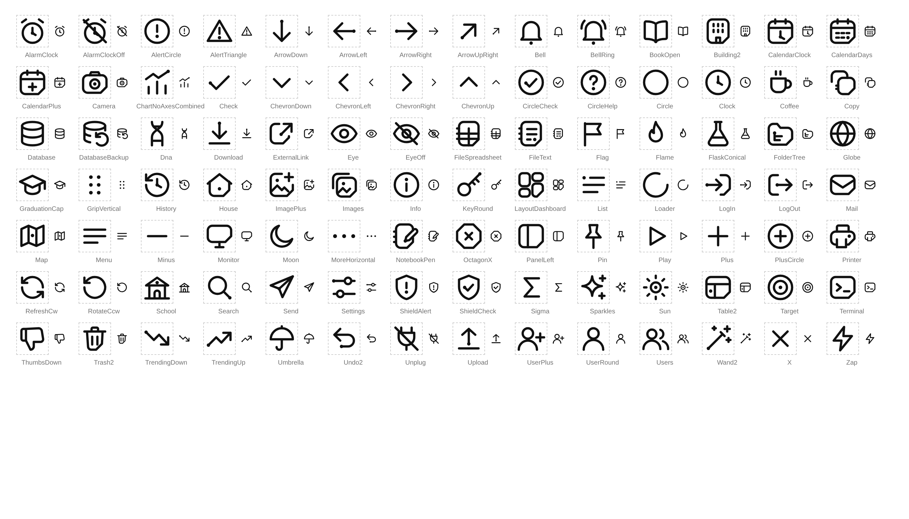
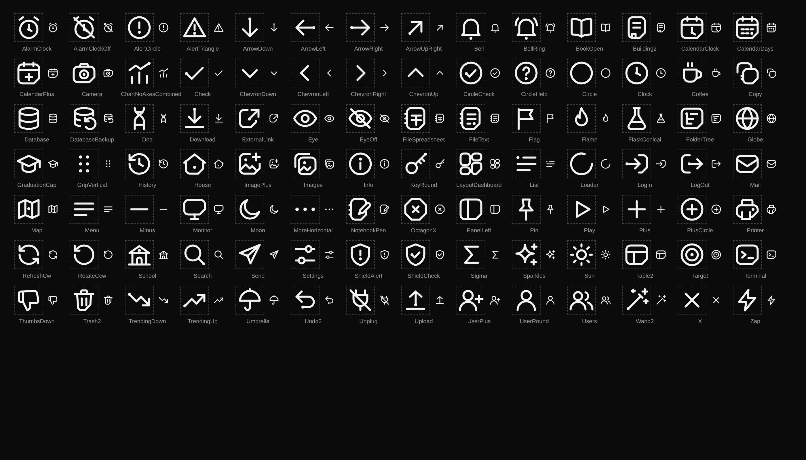
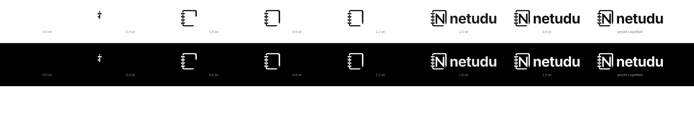
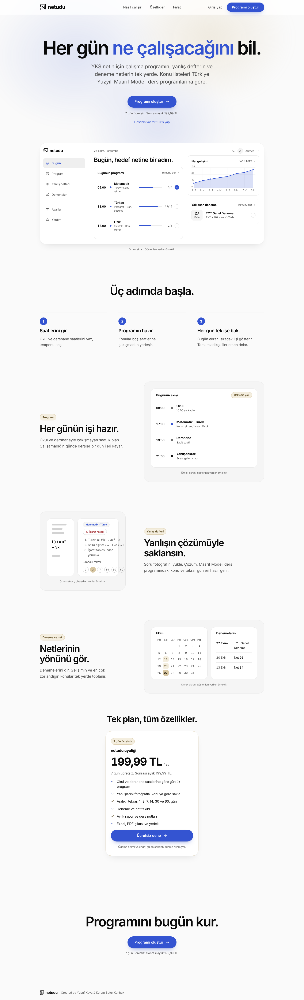
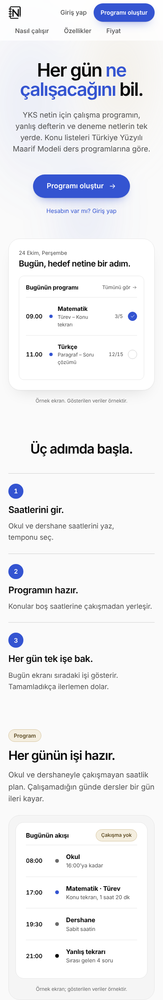
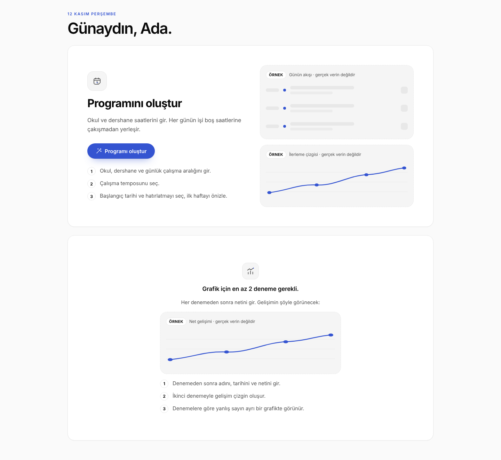
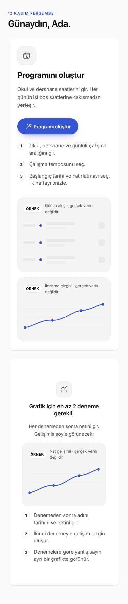

# KANIT — font-ikon-logo

| Görev | Tür | Aralık | Tur | Yazar modeli |
|---|---|---|---|---|
| Tek font ailesi (Manrope), özel simge seti, animasyonlu yükleme logosu, boş durumlar | görsel | a138d62..bu turun commit'i | 1 | sonnet |

## İddia
- [ ] Tüm sitede tek font ailesi (Manrope, next/font/google) kullanılır; Poppins ve diğer aileler kaldırıldı.
- [ ] `lucide-react` içe aktarımı app/ ve components/ altında 0; 109 içe aktarılan ad yeni modülde dışa aktarılıyor.
- [ ] 98 özgün glif, 24x24 ızgara, 1.75 çizgi, tek kaynak (glyphs.ts); 20px ve 48px'te okunur.
- [ ] Yükleme logosu: sekmeler/alt kenar/çerçeve çizilir, kalem ucu, kıvılcım, N, "netudu"; son kare LogoMark ile aynı; reduced-motion'da tam logo.
- [ ] Boş durumlar "Örnek" etiketli iskelet + 3 adımla doldu; yanlış defterinde gerçek veriden özet şeridi.

## Önce
Poppins `@font-face` (public/fonts/*.woff2) + Segoe UI/SF yığını; 42 dosyada `lucide-react`; yükleme ekranı: logo + dönen halka; boş durumlarda tek kart/tek cümle.

## Sonra
Simgeler:  
Logo film şeridi (0, .2, .4, .6, .8, 1.0, 1.3 sn; sağda gerçek LogoMark; Tur 3 doğrulaması: kare etiketleri görüntüde okundu): 
Açılış:   Boş durumlar:  
Not: önizlemelerde ağ olmadığından Manrope yüklenmez; sistem yedek fontu görünür. Tailwind sınıfları statik HTML'de çalışmaz; yalnız düz CSS sınıflı bölümler önizlendi.

## Test / Ölçüm
| Komut | Beklenen | Gerçek | Çıkış kodu | Sonuç |
|---|---|---|---|---|
| `node ts-check.js` (değişen .tsx) | OK | hepsi OK | 0 | PASS |
| `node names-check.js` | temiz | temiz | 0 | PASS |
| `python3 class-check.py` | 0 tanımsız sınıf | 0 | 0 | PASS |
| `python3 check-css.py app/globals.css` | parantez dengeli | dengeli; tanımsız: --d --sp --sy --v (satır içi) ve --font-manrope (next/font) | 0 | PASS |
| `palette-check.py` | boş | boş | 0 | PASS |
| streak / scheduler / apple testleri | geçer | 9/9, 26, 15 | 0 | PASS |
| grep `lucide-react` app components | 0 | 0 | - | PASS |
| içe aktarılan simge adı ⊂ dışa aktarılan | eksik yok | eksik yok (109 ad) | - | PASS |
| `next build` | - | YAPILAMADI (ağ yok); next/font/google derlemesi doğrulanamadı | - | YAPILAMADI |

## Orkestratör doğrulaması
(orkestratör doldurur)

## Kapsam dışı / bilinen eksikler
- Gerçek tarayıcıda uygulama çalıştırılamadı; Manrope yüklemesi doğrulanamadı.
- Madde 4 kısmi: boş durumlar (program, deneme, yanlış defteri, rapor, not) ve yanlış defteri özet şeridi eklendi; açılış sayfası mevcut yapısıyla bırakıldı; ayarlar/denemeler/notlar için ek şerit eklenmedi (denemelerde zaten özet var).
- Yükleme ekranı en az gösterim süresi yok: yalnız 100 ms gecikmeli belirir; içerik gelince ani kapanır (içerik animasyonları devreye girer).
- Doğrulama sonrası eklenen fallback `var(--font-manrope,Manrope)`; e-posta HTML'inde font-family sistem yığınıdır (web fontu e-postada çalışmaz).

## Yeniden üretme
1. Bu turun commit'ini checkout et.
2. Betikler scratchpad'de: icons-preview.mjs, logo-frames.cjs, pages.cjs.

## Orkestratör doğrulaması (tur 1)
- Görüntülere bakıldı: `logo-frames.png` (sıra: sekmeler → çerçeve → kalem ucu → N → yazı; son kare gerçek LogoMark ile aynı), `icons-light.png` (98 glif, 20 ve 48px okunur, taşan/boş yok), `empty-1440.png` ve `empty-390.png` (iki sütun → tek sütun, taşma yok).
- `check-css.py`: parantez farkı 0; tanımsız yalnız `--d --sp --sy --v` (satır içi) ve `--font-manrope` (next/font tanımlar).
- `ts-check.js`: 0 sözdizimi hatası. `names-check.js`: temiz (taban koddaki D1/R2 tip uyarıları hariç).
- Simge dışa aktarım denetimi (ayrı betik): 109 dışa aktarım, içe aktarılıp eksik kalan ad 0.
- `lucide-react` içe aktarımı: 0 dosya. Poppins kalıntısı: 0.
- Testler: streak 9/9, scheduler+pricing 26, apple 15.
- YAPILAMADI: `next build` (next/font/google indirmesi yalnız Vercel derlemesinde sınanır), gerçek uygulamanın tarayıcıda çalıştırılması, Manrope'nin görsel kontrolü (önizlemeler yedek fontla).
- Gözlem: simge seti tutarlı ve temiz, ancak imza motifi zayıf; genel çizgi simge setlerine yakın duruyor.


## Tur 2 (inceleme turu 1 bulguları)

### Düzeltmeler
- **ÖNEMLİ-1 simge imzası**: `components/icons/glyphs.ts` baştan yazıldı; üç kural tüm sete uygulandı ve dosya başındaki yorumda anlatıldı (Lucide path verisi kopyalanmadı).
  - K1 kalem ucu köşesi: `F()` yardımcısı (üç köşe r=3.5, sağ alt 45 derece pah, 4.5 birim). 23 simge. Pahın içine iç öğe taşmaması için ImagePlus, Images, House, Printer, NotebookPen, CalendarClock, Building2 yeniden yerleştirildi.
  - K2 mürekkep noktası: `D()` = `class="nd-ink"`, r=1.3, simge başına en fazla 1 (denetimde ink>1: yok; ink=1: 45 simge). Eski çoklu nokta kümeleri (Building2 pencereleri, CalendarDays günleri, List madde imleri) çizgiye çevrildi. GripVertical/MoreHorizontal noktaları içeriğin kendisi olduğundan nd-ink değil (`Dp`).
  - K3 defter sekmeleri: FileText, FileSpreadsheet, NotebookPen (sol kenardan 1.5 birim taşan 3 sekme), Copy ön yaprağı (2 sekme). Kıvrık köşeli klasik dosya formu kaldırıldı.
  - CSS (`app/globals.css` sonu): `.nd-ink{fill:var(--icon-ink,currentColor)}`; `--icon-ink:var(--brand-ink)` seçili gezinme öğesi, `.empty-ico`, `.lp-plan` (fiyat kartı), `.target-card`. Not: koyu temada `--brand` #3454D1 koyu zeminde zayıf kaldığı için okunur ton olan `--brand-ink` (#8DA2F2) kullanıldı; açık temada ikisi aynı.
  - Gözle-düzelt turları: Tur A (48px, açık) bulgusu: Building2 pencere çizgileri kalabalık/kapı çok küçük, Copy arka yaprağı ön yaprağa yapışıp topak gibi, FileSpreadsheet iç ızgarası 20px'te bulanık. Düzeltildi (pencere 2 uzun çizgi, Copy arka yaprağı açık L, tablo tek kırık çizgi ızgarası). Tur B (48px koyu + accent + 20px büyütülmüş kırpma): K1 pahı tüm çerçevelerde aynı konumda ve ölçüde; K2 tek ve yerinde (saat merkezi, ok kuyruğu, mercek sapı, zil tokmağı, hedef merkezi, kalem ucu); 20px'te bulanan simge görülmedi (CalendarDays en yoğunu, okunuyor).
- **ÖNEMLİ-2**: `app/study/plan/ui.tsx` adım 1 "Okul, dershane ve günlük çalışma aralığını gir." (sihirbazda uyku alanı yok). Adım 3 de gerçek ekrana göre düzeltildi: "Başlangıç tarihi ve hatırlatmayı seç, ilk haftayı önizle." (eski "Özeti gör, programı başlat" sihirbazda özet ekranı yok).
  Tüm boş durum adımları gerçek alanlarla karşılaştırıldı:
  - plan/ui adım 1: sihirbaz adım 1 = okul (gün, başlangıç, bitiş, ad), diğer sabit saatler (dershane/özel ders/kurs), günlük çalışma aralığı (en erken/en geç). Düzeltildi. Adım 2 tempo seçimi: var. Adım 3: düzeltildi.
  - exams: "adını, tarihini ve netini gir": form alanları Deneme adı, Tarih, Sınav, Net, Doğru, Yanlış, Boş: tamam. "İkinci denemeyle gelişim çizgin": grafik `netData.length>=2`: tamam. "Yanlışların denemeye göre dağılımı yanına eklenir": ayrı bir "Denemelere göre yanlış sayın" grafiği var ama "dağılım/yanına" belirsizdi; "Denemelere göre yanlış sayın ayrı bir grafikte görünür." yapıldı.
  - report: "Yanlışlarını deneme sonrası defterine ekle", "sayıya göre sıralanır", "geçen aya göre değişim" (`delta(t)` okları): tamam, değişiklik yok.
  - notes: "Ders ve Maarif konusunu seç" (Ders + Konu seçicileri), "Notu hazırla" düğmesi: tamam. "Notu kısalt, genişlet" düğmeleri yoktu; gerçek özellik "Notu değiştir" metin kutusu (örn. "daha kısa olsun"), Yazdır ve yanlışlara git: düzeltildi.
  - archive: yalnız örnek iskelet, adım listesi yok.
- **3 başlık kademesi**: genel h1/h2/h3/h4 kuralları `@layer base` içine alındı ve çakışan iki ölü yinelenen kural (satır 6 ve 286'daki çıplak h1/h2) silindi. Gerekçe: Tailwind v4 yardımcıları `@layer utilities` içindedir; katmansız her kural, `:where()` ile özgüllüğü sıfır bile olsa, katmanlı yardımcıyı yener. Yalnız `:where()` yetmez; katman gerekir. Preflight aynı katmanda `(0,0,1)` olduğundan base içinde `:where` kullanılmadı (sıra kazanır). Basamaklama doğrulaması (Playwright, gerçek `globals.css`, Tailwind katmanı benzetimiyle):
  - Önce (HEAD) 390px: h1 28.25px (1.9rem kuralı kaybediyordu), h2 20px (1.08rem kaybediyordu).
  - Sonra 390px: h1 30.4px (=1.9rem), h2 17.28px (=1.08rem). 1440px: tüm başlıklar önceki değerlerle birebir aynı (h1 40px/700, h2 20px/650, h3 16px/650).
  - Dialog başlığı benzetimi `text-lg leading-none font-semibold`: 1440px 18px/600/line-height 18px (yardımcılar kazanıyor; önce v12 kuralı 20px/650 veriyordu). 390px'te katmansız mobil `h2{1.08rem}` kuralı text-lg'yi yener (17.28px), bu kasıtlı mobil kural.
- **4**: `SampleSkeleton` varsayılan etiketi "Önizleme" ("ÖRNEK Örnek önizleme" yinelemesi bitti); `Empty` `sampleLabel` aldı: exams "Net gelişimi", report "Konu sıralaması".
- **5**: `.settings-icon svg{width:22px;height:22px}`.
- **6**: yükleme logosu animasyonu 1.75 sn -> ~1.15 sn (tüm süre/gecikmeler x0.66: sekmeler .03+i*.06 -> çerçeve .1/.5 sn -> uç .58 -> N .75 -> yazı .86). Sıra korunmuş. `logo-frames.png` yeniden üretildi (kareler 0, .2, .4, .6, .8, 1.0, 1.3 sn): 0.2'de sekmeler, 0.4'te çerçeve+alt kenar, 0.6'da çerçeve tamam, 0.8'de uç/N başlıyor, 1.0 ve 1.3'te tam logo + yazı. Gösterim süresi için JS eklenmedi.
- **7**: `package.json` / `lucide-react` bağımlılığına dokunulmadı (kilit dosyası; kodda içe aktarım 0, kaldırma kararı sonraya).

### Kural tablosu (98 simge)
| Kural | Adet | Simgeler |
|---|---|---|
| K1 + K2 + K3 | 2 | FileText, NotebookPen |
| K1 + K2 | 10 | CalendarClock, CalendarDays, Camera, ExternalLink, FolderTree, House, ImagePlus, Images, LogIn, Printer |
| K1 + K3 | 2 | Copy, FileSpreadsheet |
| K1 | 9 | Building2, CalendarPlus, LayoutDashboard, Mail, Monitor, PanelLeft, Table2, Terminal, Trash2 |
| K2 | 33 | AlarmClock, AlarmClockOff, AlertCircle, AlertTriangle, ArrowDown, ArrowLeft, ArrowRight, ArrowUpRight, Bell, BellRing, ChartNoAxesCombined, Check, CircleCheck, CircleHelp, Clock, Download, History, Info, KeyRound, List, LogOut, Map, School, Search, Send, ShieldAlert, ShieldCheck, Target, TrendingDown, TrendingUp, Undo2, Upload, Wand2 |
| yok | 42 | BookOpen, ChevronDown, ChevronLeft, ChevronRight, ChevronUp, Circle, Coffee, Database, DatabaseBackup, Dna, Eye, EyeOff, Flag, Flame, FlaskConical, Globe, GraduationCap, GripVertical, Loader, Menu, Minus, Moon, MoreHorizontal, OctagonX, Pin, Play, Plus, PlusCircle, RefreshCw, RotateCcw, Settings, Sigma, Sparkles, Sun, ThumbsDown, Umbrella, Unplug, UserPlus, UserRound, Users, X, Zap |

Not: LogOut (sol açık ayraç, sağ alt köşe yok), Shield*, Search, Pin vb. çerçevesiz olanlar K1 dışındadır. FolderTree artık çerçeveli bir panel içinde ağaç çizgisi (K1+K2). LayoutDashboard'da yalnız dış alt-sağ kutu pahlıdır (diğer üç iç kutu r=2.5 düz).

### Gerçek komut çıktıları
```
python3 check-css.py app/globals.css
  süslü parantez: açık-kapalı farkı = 0 | en düşük derinlik = 0
  parantez ( ) farkı = 0
  tanımlı değişken: 127 | kullanılan: 100 | TANIMSIZ: ['--d', '--font-manrope', '--sp', '--sy', '--v']
node ts-check.js (ui, shared, exams, notes, report, glyphs, index)  -> hepsi OK
node names-check.js (aynı dosyalar)  -> TEMİZ: tanımsız ad / kullanılmayan değişken-import yok
python3 class-check.py  -> TANIMSIZ SINIF SAYISI: 0
python3 palette-check.py -> çıkış 0 (çıktı yok)
streak: 9/9 PASS            (çıkış 0)
scheduler+pricing: 26 test geçti (çıkış 0)
apple: 15 test geçti        (çıkış 0)
simge denetimi (icon-audit.mjs): dışa aktarılan: 109 | içe aktarılan ad: 109 | EKSİK: [] | bilinmeyen glif: []
  geçerli XML dışı: [] | glif sayısı: 98 | ink>1: [] | ink=1: 45 | ink=0: 53
  güvenli kenar <1 (stroke dahil): Bell, BellRing 0.62 (yanlış alarm: tokmak dolu nokta, strokesuz; gerçek boşluk 1.5)
```

### Görüntüler
- `docs/proof/font-ikon-logo/icons-light.png`, `icons-dark.png` (48px + 20px, 98 simge)
- `docs/proof/font-ikon-logo/icons-accent.png` (48px, nokta `--icon-ink` kobalt; sol yarı açık tema, sağ yarı koyu tema, iki yarıda farklı simgeler görünür)
- `docs/proof/font-ikon-logo/logo-frames.png`

### Bilinen eksikler (tur 2)
- `next build` ve gerçek uygulamada Tailwind çıktısı çalıştırılamadı (node_modules yok); katman basamaklaması Tailwind katman sırası benzetimiyle doğrulandı.
- (Tur 3 ile giderildi: `nav-accent.png`, gerçek `app/globals.css` ile.) Gerçek Next sayfasında bakılmadı.

## Tur 3 (inceleme turu 2 bulguları)

### Düzeltmeler
- **ÖNEMLİ-1 eski görüntüler**: `empty-1440/390.png` ve `landing-1440/390.png` HEAD (a87b79a) JSX metinleriyle yeniden üretildi. Betik: statik HTML metinleri `app/study/plan/ui.tsx` (PlanStart), `app/study/shared.tsx` (SampleSkeleton, Empty), `app/study/exams.tsx` (grafik boş durumu), `app/study/landing.tsx` ve `landing-sections.tsx` ile birebir eşlendi; Tur 2'deki uydurma "Not: son şerit..." paragrafı ve stat-strip kaldırıldı; örnek grafikteki 4 nokta eklendi; açılışa Fizik satırı, net grafiği, yaklaşan deneme, Ayarlar/Yardım, üç fayda, fiyat kartı, kapanış ve altbilgi eklendi. Okundu: eski "uyku", "Özeti gör, programı başlat", "Örnek önizleme" metinleri yok; adımlar "Okul, dershane ve günlük çalışma aralığını gir. / Çalışma temposunu seç. / Başlangıç tarihi ve hatırlatmayı seç, ilk haftayı önizle." ve "Denemelere göre yanlış sayın ayrı bir grafikte görünür."; örnek etiketi "Net gelişimi". CSS çalışma ağacındaki (Tur 3) `app/globals.css`.
- **KÜÇÜK-2**: depo kökündeki `ink.json` geçici denetim çıktısı `git rm` ile silindi (5174bfd ile commitlendi). Not: `icon-audit.mjs` çalışma dizinine `ink.json` yazıyor; denetim çıktısı silindi.
- **KÜÇÜK-3 mürekkep noktası vurgusu**: nokta çizgiyle aynı renkteydi (çizgi `--brand-ink`). Şimdi çizgi nötr, nokta kobalt (`--icon-ink:var(--brand-ink)`):
  - Seçili gezinme: çizgi `var(--fg)`; `.empty-ico`, `.plan-start-ico` (aynı sorun, aynı düzeltme), `.target-card` (3 seçici): çizgi `var(--fg2)`. `.empty-ico svg{color:inherit}` ile `.empty svg` kuralı geçersiz kılındı.
  - Seçili durum yalnız renge dayanmıyor (kontrol edildi, korundu): `--sel` zemini, sol gösterge çubuğu (`::before`), `font-weight:600`, çizgi `--fg`.
  - Gezinme/boş durum simgelerinde nokta durumu: Sun (yoktu, eklendi: merkez), CalendarDays (var), Table2 (yoktu, eklendi: sol hücre), ChartNoAxesCombined (var), TrendingUp (var), NotebookPen (var), Settings (yoktu, eklendi: üst çizgi başı), Wand2 (var), CalendarClock (var); boş durum varsayılan BookOpen (yoktu, eklendi: sayfaların birleştiği alt nokta). Kural korundu: simge başına en fazla bir nokta.
  - Kapsam notu: `.lp-side li.on` (açılıştaki örnek kenar çubuğu) bu turda değiştirilmedi; nokta orada `currentColor`.
- **KÜÇÜK-4 belirsiz simgeler** (`components/icons/glyphs.ts`): Building2 = pahlı 16x18 gövde + 3x2 dikey pencere çizgisi + ortada kapı; FolderTree = sekmeli klasör gövdesi (K1 pahlı) + ağaç gövdesi/dalları + kök noktası (K2); FileSpreadsheet = sekmeli belge + iki yatay (sekmelerle hizalı, kenardan kenara) + bir dikey çizgi. 48px ve 20px (4x büyütülmüş) bakıldı: Building2 bina, FolderTree klasör, FileSpreadsheet ızgara olarak okunuyor; ek tura gerek görülmedi. K2 anlatımı düzeltmesi: Tur 2'deki "ink=1: 45 simge" artık 49 (Sun, Table2, Settings, BookOpen eklendi); Building2 ve FileSpreadsheet noktasız. Kural tablosundaki FolderTree satırı: çerçeve yerine sekmeli klasör yolu (K1 pahı ve K2 var).

### Gerçek komut çıktıları (Tur 3)
```
python3 check-css.py app/globals.css
  süslü parantez: açık-kapalı farkı = 0 | en düşük derinlik = 0
  parantez ( ) farkı = 0
  tanımlı değişken: 127 | kullanılan: 100 | TANIMSIZ: ['--d', '--font-manrope', '--sp', '--sy', '--v']   (Tur 2 ile aynı; çalışma anı değişkenleri)
node ts-check.js glyphs.ts index.tsx -> OK, OK
python3 class-check.py -> TANIMSIZ SINIF SAYISI: 0
python3 palette-check.py -> çıkış 0 (çıktı yok)
node icon-audit.mjs
  dışa aktarılan: 109 | içe aktarılan ad: 109 | EKSİK: [] | bilinmeyen glif: []
  geçerli XML dışı: [] | glif sayısı: 98
  ink>1: [] | ink=1: 49 | ink=0: 49
  güvenli kenar <1 (stroke dahil): Bell, BellRing 0.62 (Tur 2'deki yanlış alarm; tokmak strokesuz dolu nokta)
```
Kontrast (WCAG, hesap): açık: çizgi fg/--sel 17.22, fg2/inner 7.17, fg2/surface 7.81, kobalt #3454D1 nokta / sel 5.48, inner 5.78, surface 6.30. Koyu: fg/--sel 15.96, fg2/inner 7.49, fg2/surface 7.85, #8DA2F2 nokta / sel 7.11, inner 7.72, surface 8.09. Hepsi 4.5 üstü.

### Görüntüler ve commit durumu
Tümü, `a87b79a` (HEAD) üzerindeki çalışma ağacı (commitlenmemiş Tur 3 değişiklikleri: `app/globals.css`, `components/icons/glyphs.ts`) durumundan alındı:
- `icons-light.png`, `icons-dark.png`, `icons-accent.png` (açık üstte, koyu altta; 98 simge)
- `nav-accent.png` (açık üstte, koyu altta: gezinme simgeleri + etiketler, "Program" seçili; boş durum ikon kutuları BookOpen, NotebookPen ve CalendarClock; hedef kartı)
- `empty-1440.png`, `empty-390.png`, `landing-1440.png`, `landing-390.png` (statik HTML + gerçek `app/globals.css`)
- `logo-frames.png`: a87b79a (Tur 2) durumundan; Tur 3 logoya dokunmadı.

### Bilinen eksikler (tur 3)
- Önizlemeler statik HTML'dir (node_modules yok, `next build` çalıştırılamadı); metinler JSX'ten elle eşlendi.

## Tur 3 — inceleme sonucu (orkestratör)
- İnceleme 3: SKOR 5, PRODUCTION_READY, ENGELLEYİCİ/ÖNEMLİ yok (opus-5-5, taze bağlam).
- Orkestratör yeniden doğrulama: CSS parantez dengesi, tip denetimi (glyphs/index), tanımsız sınıf, simge dışa aktarımı (109/109), testler (streak 9, scheduler+pricing 26, apple 15) → PASS. `next build` bu ortamda çalıştırılamadı (npm 403); son doğrulama Vercel önizleme derlemesidir.
- Açık KÜÇÜK notlar (kapsam dışı): `lucide-react` ölü bağımlılık; mobil alt çubukta seçili simge tümüyle kobalt; `.app-sidebar .target-card svg` şampanya kuralı etkisiz; FileSpreadsheet yatayları sekmelerle birleşiyor.

## Tur 4 — açılış kapısı
İstek: oturum hızlı çözülse de logo animasyonu bitmeden site açılmasın.

### Ne değişti (yalnız `app/study-app.tsx`, +5/-2)
- `BOOT_MIN_MS=1410` sabiti (tek yorum satırıyla CSS ilişkisi belirtildi).
- `bootDone` durumu (başlangıç false) ve bir `useEffect`: `prefers-reduced-motion: reduce` ise hemen true; değilse `setTimeout(BOOT_MIN_MS)` ile true (temizlikli). Effect, erken `return`'lerden önce (satır 75 civarı) olduğundan Hooks sırası değişmedi.
- Kapı `if(authed===null||!bootDone)return <BootScreen/>;` `authed===false` dalından önce; Landing de bekletilir. Sonraki `setAuthed(null)` (giriş sonrası) BootScreen'i yine gösterir, ama `bootDone` true kaldığı için ek bekleme yok. `load()` ve hata/offline akışı değişmedi.

### Hesap
`globals.css` `.logo-anim`: en geç biten öğe wordmark `.86s + .3s = 1.16s`; `.boot` fade `.1s + .25s = .35s`. Maks = 1.16s + 0.25s nefes = 1410 ms.

### Komutlar ve çıktı
- `node ts-check.js app/study-app.tsx` -> `OK   app/study-app.tsx`, çıkış 0.
- `node boot-sim.cjs` (CSS'ten süreleri okur, sabiti kaynaktan çeker, zamanlayıcı kapısını simüle eder):
```
öğe bitişleri(s): 0.41 0.46 0.60 0.69 0.97 1.16 | logoEnd 1160 bootEnd 350 | BOOT_MIN_MS 1410 pay 250
PASS sabit >= bitiş
authedAt=50 reduced=true: içerik 50ms'de açıldı
authedAt=50 reduced=false: içerik 1409ms'de açıldı
authedAt=3000 reduced=false: içerik 3000ms'de açıldı
```
- streak/scheduler/pricing/apple testleri: bu turda yeniden koşulmadı (depoda test dosyası yok; önceki turlardaki geçici betikler bu diff'in dokunmadığı `lib/` dosyalarını sınar). Diff yalnız `app/study-app.tsx`.

### Bilinen sınırlar
- Gerçek tarayıcıda zamanlama görülmedi (`next build` ve Playwright'lı sayfa bu ortamda yok); simülasyon yalnız kapı mantığını ve süre >= bitiş koşulunu gösterir.
- Sabit CSS süreleriyle elle eşleşir; CSS değişirse güncellenmeli (yorumda belirtildi).
- BootScreen -> içerik geçişi anidir (çıkış animasyonu eklenmedi; istek gereği basit tutuldu).
