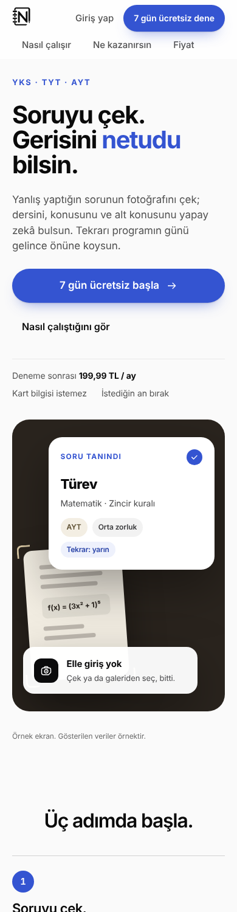
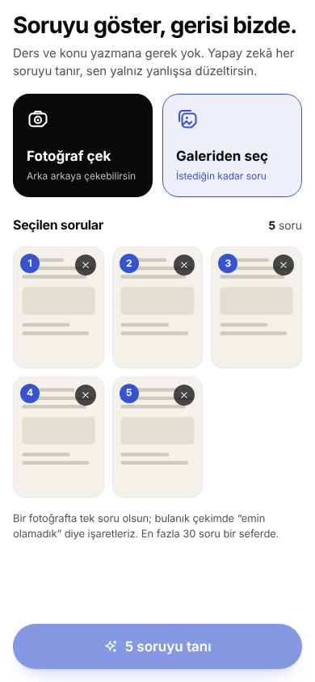
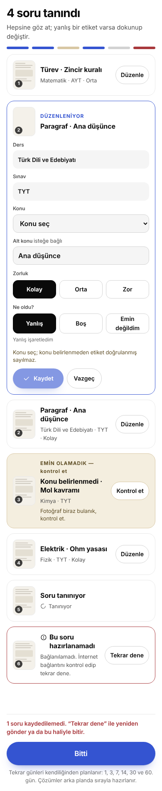
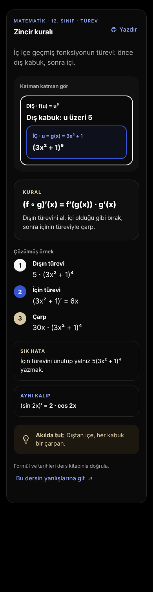

# KANIT — foto-soru-gorsel-not

| Görev | Tür | Aralık | Tur | Yazar modeli |
|---|---|---|---|---|
| Yanlış ekle: yalnız fotoğraf + yapay zekâ sınıflandırma + etiket ekranı; görsel ders notu; giriş sayfasında mor parıltı yerine fotoğraf paneli | karma | 9c3c24f..bu turun commit'i | 1 | sonnet |

## İddia
- [ ] Sınıflandırma çıktısı güvenle doğrulanır: geçersiz ders mevcut derse düşer, konu MEB listesine eşlenir, güven eşiği 0,6, bozuk girdi hiçbir zaman fırlatmaz (classify.test.mjs, 17 test).
- [ ] POST /api/questions için deneme adı, tarih, sınav, ders zorunlu değil; varsayılanlar (bugün, "Yanlış defteri", profil sınıfı, ilk ders + "Konu belirlenmedi" + kontrol bayrağı) (question-defaults.test.mjs, 8 test).
- [ ] Not JSON şeması doğrulanır, eski markdown notlar eskisi gibi çizilir, bozuk önekli kayıt çökmez (note-format.test.mjs, 11 test).
- [ ] Veritabanı şeması değişmedi; alt konu/zorluk/güven `questions.analysis` JSON'unda `classification` anahtarında, görsel not `study_notes.content` içinde "ndnote1:" önekli JSON. memory-db üzerinde INSERT/UPDATE denendi.
- [ ] Giriş: mor/radyal parıltı ve ndDrift kaldırıldı; fotoğraf yokken "FOTOĞRAF" yer tutucusu yok, ürün kartlarından kompozisyon görünür (landing-1440.png, landing-390.png).
- [ ] Yanlış ekle ve etiket ekranı, görsel not 390 px'te taşmıyor (sw=cw ölçümü), koyu temada okunur.
- [ ] Eski testler yeşil.

## Önce
Mantık kanıtı: yeni özellik. Kırmızı adım: ilk koşuda lib/classify.ts, question-defaults.ts, note-format.ts yoktu ve testler modül bulunamadı hatasıyla düştü (not: ilk iki koşuda ND_ROOT tanımsızdı, yani kırmızı "modül yok"tan çok yükleyici hatasıydı; note-format için tam kırmızı gözlendi). Eski giriş/yükleme görselleri alınmadı.

## Sonra
Görseller **statik önizlemedir** (static-preview.mjs): gerçek app/globals.css + GERÇEK Landing, NoteBody, TagReview, UploadDialog bileşenlerinin react-dom/server çıktısı; radix Dialog/Select düz karşılıklarla (ui-stubs.tsx) yerine konuldu. Durum gerektiren iki parça ELLE yazıldı: seçilen fotoğraf ızgarası ve açık "Düzenle" kartı. Next/React tarayıcıda çalıştırılmadı; yazı tipi Manrope değil yedek. Kart içerikleri ve küçük resimler örnektir.
-   (fotoğrafsız kompozisyon)
-   
-     (akış, karşılaştırma, döngü)  (eski not)

## Test / Ölçüm
Yükleyici: bu dizindeki reg.mjs/reg2.mjs (+hook, server-stub). Hepsi `ND_ROOT=$PWD` ile.
| Komut | Beklenen | Gerçek | Çıkış kodu | Sonuç |
|---|---|---|---|---|
| classify.test.mjs | yeşil | 17 test geçti | 0 | PASS |
| question-defaults.test.mjs | yeşil | 8 test geçti | 0 | PASS |
| note-format.test.mjs | yeşil | 11 test geçti | 0 | PASS |
| soru-bankasi resources / queue / resource-schema | yeşil | 53 / 3 / 11 test geçti | 0 | PASS |
| tools scheduler / streak / apple | yeşil | 26 / 9 / 15 | 0 | PASS |
| ts.transpileModule, 24 değişen .ts/.tsx | hata 0 | 24/24 OK | 0 | PASS |
| memory-db INSERT (19 sütun) + UPDATE + PATCH denemesi | satır doğru | classification JSON yazıldı/okundu | 0 | PASS |
| check-css.py | fark 0 | 0 / 0; tanımsız yalnız --cols (satır içi), --d, --font-manrope, --sp, --v (eskiden var) | 0 | PASS |
| class-check.py | yeni sınıflar tanımlı | kalanlar dinamik (c/d/s, nv-) ve sr-only (Tailwind) yanlış pozitifleri | 0 | PASS |
| icon-audit.mjs | eksik yok, ink≤1 | EKSİK [] · ink>1 [] · yeni Lightbulb kenar ≥1 (Bell/BellRing 0.62 eskiden var) | 0 | PASS |

## Orkestratör doğrulaması
(Orkestratör tarafından doldurulur.)

## Kapsam dışı / bilinen eksikler
- Gerçek OpenAI çağrısı ve `next build`/tam tsc çalıştırılmadı; sınıflandırma istemi ve not şeması gerçek modelle denenmedi.
- Fotoğraf dosyası yok: lib/hero.ts HERO_PHOTO=null. Dosya eklenince yol yazılır.
- Zorluk/alt konu/güven yalnız analysis.classification içinde; arşiv filtresi/rapor bunları kullanmıyor (yalnız kart ve "Kontrol et" rozeti).
- Eski Preview/NetChart kodu kaldırıldı; ilgili .lp-preview/.lp-card CSS kuralları globals.css'te ölü kaldı.
- Program ön ayarıyla açılan yükleme (plan/ui.tsx) artık soru metni almıyor; ders+konu ön ayarı varsa sınıflandırma atlanır.

## Yeniden üretme
1. Bu turun commit'ini checkout et (PR head'i).
2. `P=docs/proof/foto-soru-gorsel-not; ND_ROOT=$PWD node --experimental-strip-types --import ./$P/reg2.mjs $P/classify.test.mjs` (aynısı question-defaults, note-format).
3. Eski testler: soru-bankasi-oynatma-listesi PROOF'undaki komutlar.
4. Önizleme: `ND_ROOT=$PWD PLAYWRIGHT_BROWSERS_PATH=/opt/pw-browsers NODE_PATH=/opt/npm-tools/node_modules node --experimental-strip-types --import ./$P/reg.mjs $P/static-preview.mjs`.

## Orkestratör doğrulaması (tur 1)
- Testler bağımsız yeniden koşuldu (ND_ROOT=$PWD): classify 17, note-format 11, question-defaults 8, resources 53, queue 3, scheduler+pricing 26, streak 9/9, apple 15 → hepsi geçti.
- Görsellere bakıldı: landing-1440 (mor parıltı yok, fotoğrafsız kompozisyon, yer tutucu yazısı yok), tag-review-390, note-visual-390 — taşma yok.
- Gerçek OpenAI çağrısı, React etkileşimi ve next build çalıştırılmadı.

## Tur 2 (inceleme 1 düzeltmeleri; bulgular: REVIEW-1.md)
Komutlar `ND_ROOT=$PWD` ile; testler önce kırmızı koşuldu (classify 5, report 4, note-format 5 FAIL), sonra yeşil.
| Bulgu | Değişiklik | Kanıt (gerçek çıktı) |
|---|---|---|
| 1 ders değişince eski konu / belirsiz konuda "doğrulandı" | `lib/classify.ts`: `carryTopic`, `hasTopic`, `editedClassification` (konu belirsizse needsReview kalır, source ai/none); PATCH bunları kullanır; tag-review: konu yokken Kaydet devre dışı + "Konu seç" uyarısı | classify.test.mjs: 22 test geçti; tag-review-390.png |
| 2 not şeması / iade | `s(max)` kırpar; `list` öğeleri tek tek doğrular; `noteLimitsPrompt()` istemde; notes route: `respond` dönünce `charged=false` (parse null iade edilmez, ağ/OpenAI hatası iade) | note-format.test.mjs: 16 test geçti (kırpma, boş öğe, sınır). İade akışı DB gerektirdiğinden testsiz, kodla gösterildi |
| 3 koyu tema baskı | `@media print{#print-note{açık tema değişkenleri}}`, `.nv-lead` #333 | note-print-dark.png; hesaplanan: kart rgb(17,17,17) / rgb(255,255,255), kural kutusu rgb(255,255,255) / rgb(10,10,10) |
| 4 Esc/dış tık | `onOpenChange`: etiket adımında `finish()`; `finished` ref ile tek sefer | tsc transpile OK (etkileşim tarayıcıda çalıştırılmadı) |
| 5 "yeniden hazırla" | `hasSolution(a)` (steps dizisi): question-dialog + archive durum | report.test.mjs 4 test geçti |
| 6 tanınmayan sorular | `isUnrecognized`, `unrecognizedCount`; `monthlyTopics` dışlar; rapor yükünde `unrecognizedQuestions` + istem; rapor ekranında "N soru henüz tanınmadı"; arşiv ders filtresi tanınmayanı dışlar; `resolveCreate`: ders var konu yok → needsReview | report.test.mjs; question-defaults.test.mjs 9 test geçti |
| 7 solve | `solvedClassification` (okunabilir + konu → needsReview false, ders değiştiyse alt konu boş; manual dokunulmaz) | classify.test.mjs |
| 8 landing | "Tekrar: yarın", takvimde 1 vurgulu | landing-1440.png |
| 9 key | indeks anahtarları | transpile OK |
| 10 ObjectURL | unmount temizleyicisi | transpile OK |
| 11 ön ayar | ders/deneme adı konu çözülmese de gönderilir | question-defaults.test.mjs |
| 12 CSS | ölü .lp-preview/.lp-card/.lp-side/... silindi (tsx'te kullanım 0), .lp-sheet #F3EEE3, `--sy` kaldırıldı | check-css.py: parantez farkı 0, tanımsız yalnız --cols --d --font-manrope --sp --v; class-check: 0 |
| 13 parseModelNote | ilk "{" – son "}" ayıklama | note-format.test.mjs |

| Komut | Gerçek | Çıkış |
|---|---|---|
| foto-soru-gorsel-not/*.test.mjs (reg2) | classify 22, note-format 16, question-defaults 9, report 4 | 0 |
| soru-bankasi resources / queue | 53 / 3 | 0 |
| tools scheduler / streak / apple | 26 / 9/9 / 15 | 0 |
| ts.transpileModule, 16 değişen dosya | 16/16 OK | 0 |
| tsc --strict (lib/note-format, classify, study) | hata yok | 0 |
| check-css.py / class-check.py / icon-audit.mjs | yukarıdaki gibi; EKSİK [], ink>1 [] | 0 |
| static-preview.mjs | tüm görüntülerde taşma yok; tag-review-390, landing-1440, note-print-dark yeniden üretildi ve bakıldı | 0 |

Sınırlar: gerçek OpenAI/DB/React etkileşimi yok; PATCH/solve/notes route'ları birim testsiz (karar mantığı saf yardımcılarda test edildi).

## Orkestratör doğrulaması (tur 2)
- Testler bağımsız yeniden koşuldu: classify 22, note-format 16, question-defaults 9, report 4, resources 53, queue 3, scheduler+pricing 26, streak 9/9, apple 15 → hepsi geçti; ink.json/__pycache__ yok.
- note-print-dark.png açıldı: koyu temada baskı açık zeminde okunur. Not: karşılaştırma diyagramında "Karşılaştırma" etiketi solda boş alan bırakıyor (baskı genişliğinde sütunlar sağa yaslı).
