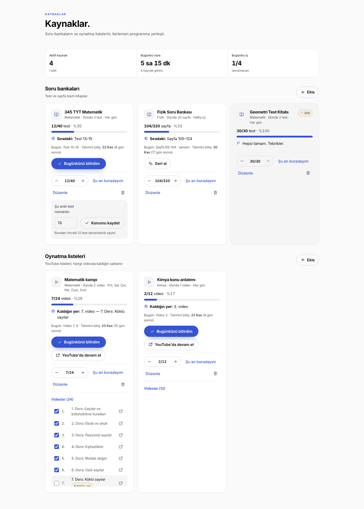
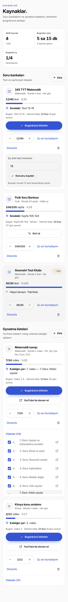
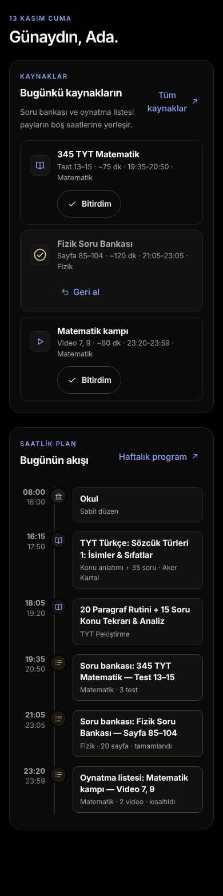
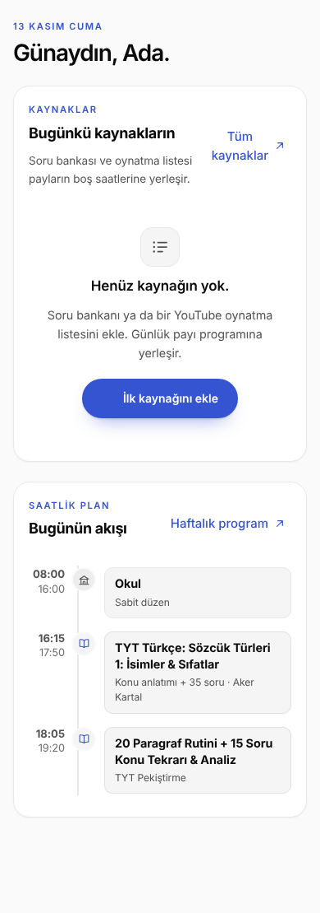
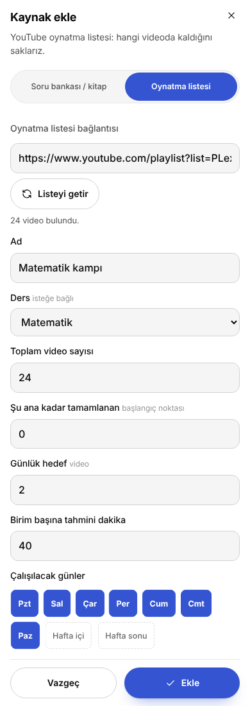
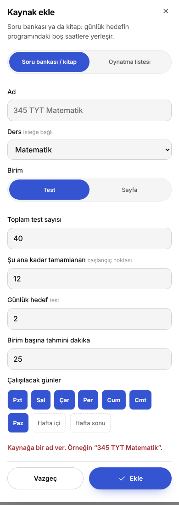

# KANIT — soru-bankasi-oynatma-listesi

| Görev | Tür | Aralık | Tur | Yazar modeli |
|---|---|---|---|---|
| Soru bankası / kitap ve YouTube oynatma listesi kaynakları; programa entegrasyon | karma | origin/main + açılış kapısı commit'i..bu turun commit'i | 2 (inceleme 1 düzeltmesi) | sonnet |

## İddia
- [x] Kaynak (soru bankası: test/sayfa; oynatma listesi) saf mantığı doğru: URL ayrıştırma, bugünkü aralık, gelecek gün tahmini, bitiş tarihi, ilerleme sınırları 0..total, watched → kaldığın yer (resources.test.mjs, 50 test, tur 2 sonrası).
- [x] buildDay kaynak bloklarını okul/sabit/ders bloklarından SONRA, çakışmadan yerleştirir; kaynaksız günde çıktı ve ders blokları değişmez; geçmiş gün ve dinlenme gününde kaynak yok.
- [x] Veritabanı şeması değişmedi; kaynaklar `config.resources` içinde; eski kayıt (resources yok, `sport` alanlı) okunur; tek bozuk kaynak programı açılmaz yapmaz; sihirbaz kaydı kaynakları ezmez (resource-schema.test.mjs, 11 test).
- [x] API eylemleri zod ile doğrulanır; playlist URL yalnız youtube.com/youtu.be/m./music. alan adı + list kimliği `^[A-Za-z0-9_-]{10,64}$`; playlistItems sayfalama, 300 sınır, hata eşlemesi sahte fetch ile doğrulandı.
- [x] Mevcut scheduler/pricing/streak/apple testleri yeşil (bozulma yok).
- [x] UI: Kaynaklar sayfası (özet, iki bölüm, kartlar, video listesi, ekle/düzenle dialogu), Bugün'de "Bugünkü kaynaklar" + boş durum; 390 px'te taşma yok (statik önizleme ölçümü), açık/koyu tema. UI React'te çalıştırılmadı; yalnız statik eşleme ve ts.transpileModule ile doğrulandı.

## Önce
Yeni özellik; "önce" davranışı yok (kaynak kavramı main'de bulunmuyor). Kaynaksız `buildDay` çıktısının değişmediği testle gösterilir (`kaynaksız: öğe ve ders bloğu değişmez`).

## Sonra
Görseller **statik önizlemedir**: gerçek `app/globals.css` + JSX'ten ELLE eşlenmiş HTML (`static-preview.mjs`; Next/React çalıştırılmadı, Tailwind preflight yerine eşdeğer temel sıfırlama eklendi, Manrope bu makinede yüklü değil, yedek yazı tipi görünür). Sayılar/etiketler (Test 13–15, tahmini bitiş, süre, zaman çizelgesi) gerçek `lib/plan` koduyla hesaplandı; kaynak adları, video başlıkları ve "Ada" ÖRNEK veridir.
-  
-  (koyu tema)  (boş durum)
-   (doğrulama hatası görünür)
Görsel düzeltmeler bu turda yapıldı: ilerleme çubuğu dolgusu (`.rc-progress .bar b`), mobil görev satırı sıkışması, tek kalan özet hücresi, ekle dialogu genişliği yalnız ≥768 px.

## Test / Ölçüm
Yükleyici: bu dizindeki `reg.mjs` (+`hook.mjs`); resource-schema için `reg2.mjs` (+`hook2.mjs`, `server-stub.mjs`: zod'u /opt/npm-tools'tan, `../server`'ı sahte modülden çözer).
| Komut | Beklenen | Gerçek | Çıkış kodu | Sonuç |
|---|---|---|---|---|
| resources.test.mjs | tüm testler geçer | `50 test geçti` | 0 | PASS |
| resource-schema.test.mjs | tüm testler geçer | `11 test geçti` | 0 | PASS |
| scheduler.test.mjs (+pricing) | yeşil | `scheduler+pricing: 26 test geçti` | 0 | PASS |
| streak.test.mjs | yeşil | `streak: 9/9 PASS` | 0 | PASS |
| apple.test.mjs | yeşil | `apple: 15 test geçti` | 0 | PASS |
| ts.transpileModule, 17 değişen .ts/.tsx | hata 0 | 17/17 OK | 0 | PASS |
| tsc (strict) lib/plan + route + UI dosyaları, modül/React türleri eksik olduğundan TS2307/7016/7026/2875/7006/7031/2786 elenerek | lib/plan ve route'ta hata yok | lib/plan ve api'de hata yok; UI'da yalnız ortam kaynaklı (React ad alanı, `key` prop, eksik tür) | — | KISMİ |
| check-css.py globals.css | süslü/parantez farkı 0 | 0 / 0; tanımsız değişkenler eskisiyle aynı (--d,--font-manrope,--sp,--sy,--v: satır içi/next-font) | 0 | PASS |
| class-check.py | yeni sınıflar tanımlı | yeni sınıfların hepsi tanımlı; kalanlar önceden var olan/dinamik (dot-, tl-, sample-, routine-dialog) ve `className={x==='test'?…}` yanlış pozitifleri | 0 | PASS |
| icon-audit.mjs | eksik/bilinmeyen glif yok, ink≤1 | EKSİK [] · bilinmeyen [] · ink>1 [] (Bell/BellRing kenar 0.62 eskiden var) | 0 | PASS |

## Orkestratör doğrulaması
(Orkestratör tarafından doldurulur; yazar boş bırakır.)

## Kapsam dışı / bilinen eksikler
- YouTube Data API gerçek çağrısı burada test edilemez (anahtar/ağ yok); yalnız sahte fetch ile eşleme/sayfalama/hata testi var.
- `next build` / tam `tsc` çalıştırılamadı (npm/proxy 403); UI davranışı React'te çalıştırılmadı, görseller statik eşlemedir.
- Yeni simge eklenmedi: Kaynaklar için `List`, kitap için `BookOpen`, liste için `Play` (mevcut glifler).
- Kaynak değişiklikleri tüm config'i oku-değiştir-yaz yapar; tek sekmede istekler tur 2'den beri sıraya alınır, İKİ AYRI sekme/cihaz arasındaki yarış sürer (mevcut plan akışıyla aynı desen).
- Silinmiş/özel videolar API'de yer tutar; numaralandırma YouTube'un listesiyle bire bir olmayabilir. 300'den uzun listelerde yalnız ilk 300 başlık saklanır (tüm kaynaklarda toplam 1500), kalan videolar "n. video" görünür.
- buildDay'e 3. parametre `today` eklendi (varsayılan UTC günü); UI çağrıları cihaz yerel gününü geçer.
- Gelecek günlerin tahmini (`unitsFor`/`finishEstimate`/`buildDay`) ileride seçilecek dinlenme günlerini bilmez: dinlenme günü (`offDays`) o gün kullanıcı eylemiyle işaretlenir, önceden bilinemez; bu yüzden tahmin "gelecekte dinlenme yok" varsayar ve o gün gelince yenilenir. `selectedBetween`'e tarih kümesi geçirilmedi (tur 3, bulgu 6).
- Mobil alt çubuğa öğe eklenmedi: Kaynaklar yan menüde ("Diğer") ve Program sayfasındaki düğmede.

## Yeniden üretme
Tüm komutlar depo kökünden, `ND_ROOT=$PWD` ile çalışır (P=docs/proof/soru-bankasi-oynatma-listesi). Araçlar `$P/tools/` altındadır.
1. Bu turun commit'ini checkout et (SHA: PR head'i).
2. Kaynak mantığı: `node --experimental-strip-types --import ./$P/reg.mjs $P/resources.test.mjs`; kuyruk: aynısı `$P/queue.test.mjs` ile.
3. Şema: aynısı `reg2.mjs` ve `resource-schema.test.mjs` ile (zod /opt/npm-tools'ta olmalı).
4. Mevcut testler: `... --import ./$P/reg.mjs $P/tools/{scheduler,streak,apple}.cur.test.mjs`.
5. CSS/sınıf/simge: `python3 $P/tools/check-css.py app/globals.css`; `python3 $P/tools/class-check.py app/study/plan/resources.tsx`; `NODE_PATH=/opt/npm-tools/node_modules node --experimental-strip-types $P/tools/icon-audit.mjs` (playwright gerekir; dosya yazmaz).
6. Önizleme: `static-preview.mjs` başlığındaki komut (playwright ve glyphs.json gerekir).

## Orkestratör doğrulaması (tur 1)
- Testler bağımsız yeniden koşuldu: resources 43, resource-schema 10, scheduler+pricing 26, streak 9/9, apple 15 → hepsi geçti (çıkış 0).
- Görseller açılıp bakıldı: resources-1440.png, today-resources-390.png (koyu), add-dialog-390.png — metin taşması yok, kartlar hizalı. Not: 1440'ta video listesi kendi içinde kayan alan olduğu için alt kenarda kırpılıyor (bilerek).
- `next build`/gerçek tsc çalıştırılamadı (npm 403); YouTube API gerçek çağrısı burada test edilemedi.

## Tur 2 (inceleme 1, SKOR 4 → düzeltmeler)
Önce kırmızı: yeni testler eklendi, kodsuz koşuldu → `44 test geçti — BAŞARISIZ VAR` (resources, 6 yeni test kırmızı) ve `10 test geçti` + FAIL (resource-schema). Sonra kod; yeşil çıktılar aşağıda.
Komutlar (depo kökünden, `ND_ROOT=$PWD`): `node --experimental-strip-types --import ./docs/proof/soru-bankasi-oynatma-listesi/reg.mjs <test>`.

| # | Bulgu | Yapılan değişiklik | Kanıt |
|---|---|---|---|
| 1 | İstekler sıraya alınmıyor | `app/study-app.tsx`: `resourceOp` promise kuyruğu (`useRef`), yanıtlar sırayla uygulanır; `resourceBusy` sayacı; kartta `aria-busy`, CSS imleç/çubuk soluklaşma | UI testi yok (React çalıştırılamadı); ts.transpileModule OK; kod incelemesi |
| 2 | fetch-playlist kullanıcı sınırsız | `lib/limits.ts`: yeni `playlist` türü (varsayılan 20, `AI_LIMIT_PLAYLIST`); route `consume` ile geçirir, 429'da "Bugünlük liste getirme hakkın doldu; video sayısını elle gir.", YouTube hatasında `refund`; `.env.example`, README, deploy betiği, `Bindings`, `shared.tsx` türü | Birim testi YOK (limits.ts sunucu/DB'ye bağlı, test yükleyicisi sahte); ts.transpileModule OK |
| 3 | `
` kapalıyken tüm satırlar | `open` durumu state'te; `<ol>` yalnız açıkken render | statik eşleme + transpile |
| 4 | aria-label başlığı eziyor | onay kutusundan `aria-label` kaldırıldı; erişilebilir ad görünür etiket metninden gelir | transpile |
| 5 | Konum formu hatada kapanıyor | `resourceOp` `Promise<boolean>`; form yalnız `ok` ise kapanır | transpile |
| 6 | Dinlenme gününde yanıltıcı metin | `unitsFor/resourceTasksForDay/finishEstimate` `todayOff` alır (bugünün kotası 0, gelecek tahmin bugünü saymaz); `buildDay` bunu geçirir; kartlar ve Bugün metni dinlenme günü için ayrı | resources.test.mjs: "dinlenme günü: bugünün kotası 0…" ve "buildDay: bugün dinlenme günüyse yarının payı…" |
| 7 | Geri al kota üstünde fazla düşürüyor | `undoToday` bugünün log'undaki tüm birimleri geri alır (kitap: done −= log.units; liste: o videolar kalkar), log sıfırlanır. Davranış notu: eski test "kota dışı manuel işaret korunur" diyordu; log tabanlı yeni kurala göre bugün işaretlenen her video geri alınır, test güncellendi | "geri al: kota üstü +1 sonrası … (16→12)", "geri al: listede …" |
| 8 | `.stat-strip` kuralı tüm şeritleri etkiliyor | kural `.res-stats` sarmalayıcısına daraltıldı (`display:contents`) | check-css; önizleme (3. hücre tam satır) |
| 9 | Dolu günde 1-2 dk kaynak bloğu + alarm | `buildDay`: `fitted=false` ve < `MIN_BLOCK` (15 dk) blok çizelgeye eklenmez (alarm yalnız `items`'tan okur); `DayPlan.resources`'ta `note:"Bugün için boş saat yok"`; Bugün listesi notu gösterir | "çok dolu gün: sığmayan ve 15 dk altı …", "rahat gün: …" |
| 10 | Toplam başlık sınırı | `LIMITS.itemsTotal=1500`, `itemsTotal()`, `resourcesSchema` (zod refine, `store.ts` kullanır), `normalizeResources` bütçe uygular, route ekleme ve fetch yolunda Türkçe hata (fetch'te limit dolmuşsa YouTube çağrılmaz, hak harcanmaz) | "toplam başlık sınırı…" (resources), "config: toplam playlist başlığı ≤1500 (zod)" (schema) |
| 11 | PROOF düzeni | kutular işaretlendi, yer tutucular silindi, reg.mjs/hook.mjs kopyalandı, yollar düzeltildi | bu dosya |

Gerçek çıktılar (son koşu):
| Komut | Çıktı |
|---|---|
| resources.test.mjs | `50 test geçti` |
| resource-schema.test.mjs (reg2) | `11 test geçti` |
| scheduler.cur.test.mjs | `scheduler+pricing: 26 test geçti` |
| streak.cur.test.mjs | `streak: 9/9 PASS` |
| apple.cur.test.mjs | `apple: 15 test geçti` |
| ts.transpileModule, değişen .ts/.tsx | 10 dosya OK, hata 0 |
| check-css.py | süslü parantez: açık-kapalı farkı = 0 | en düşük derinlik = 0 parantez ( ) farkı = 0  |
| class-check.py | TANIMSIZ SINIF SAYISI: 0 |
| icon-audit.mjs | EKSİK [] · bilinmeyen [] · ink>1 [] |
| statik önizleme | 6 görsel yeniden üretildi, taşma [] (resources-390.png açılıp bakıldı) |
Not: strict tsc (modül türleri eksik) lib/plan, lib/limits ve route'ta hata vermedi; UI dosyalarında yalnız ortam kaynaklı hatalar süzüldü.

## Orkestratör doğrulaması (tur 2)
- Testler bağımsız yeniden koşuldu (ND_ROOT=$PWD): resources 50, resource-schema 11, scheduler+pricing 26, streak 9/9, apple 15 → hepsi geçti.
- resources-390.png açılıp bakıldı: özet şeridi 2+1 düzeninde, kartlarda taşma yok.
- Kuyruk (#1), limit (#2), details/aria/form (#3–5) React'te çalıştırılmadı; yalnız kod okuması + transpile.

## Tur 3 (inceleme 2, SKOR < 5 → düzeltmeler; REVIEW-2.md)
Önce kırmızı: `resources.test.mjs` → `50 test geçti — BAŞARISIZ VAR` (shouldRefund, fitItems, hasTodayLog: "is not a function"); `queue.test.mjs` → `ERR_MODULE_NOT_FOUND lib/plan/queue.ts`. Sonra kod.

| # | Bulgu | Değişiklik | Kanıt |
|---|---|---|---|
| 1 | Her hatada hak iadesi; 400/404 (var olmayan/özel liste) kota harcayıp hak iade ediyor | `lib/plan/playlist.ts` `shouldRefund(e)`: PlaylistError 400/404 → iade yok; ağ/zaman aşımı/502/5xx/diğer → iade. `route.ts` `refund` yalnız `shouldRefund` ise | resources.test.mjs "shouldRefund…" |
| 2 | Sabırsız çift tık / iyimser durum yok | `lib/plan/queue.ts` `makeQueue` (sıralı, hata sonrası devam, sayaç); `study-app.tsx` `resourceOp` onu kullanır; `resources.tsx` kartta `resourceBusy[r.id]` doluyken bitirdim/geri al/±/konum kaydet/onay kutuları ve Bugün listesi düğmeleri `disabled` | queue.test.mjs (3 test); UI React'te çalıştırılmadı, transpile |
| 3 | Dinlenme/seçili olmayan günde log doluysa "Geri al" yok | `hasTodayLog` (resources.ts); kart `canUndo = todayU?.done \|\| (!todayU && hasTodayLog)` | "hasTodayLog…" testi; UI transpile |
| 4 | 1201–1499 arası ekleme reddi | `fitItems(list,items)`: eklemede başlıklar kalan bütçeye kırpılır; reddetme yok; yanıtta `note` (Türkçe), istemci `toast.message` ile gösterir | "fitItems…" testi (300/50/0 kalan) |
| 5 | Yorum eksik | `normalizeResources` bütçe satırına Türkçe yorum | kod |
| 6 | Gelecek dinlenme günleri | Basitçe çözülemez (dinlenme günü önceden bilinmez); "Kapsam dışı / bilinen eksikler"e yazıldı | PROOF |
| 7 | Araçlar kopyalanmamış | `tools/` altına check-css, class-check (+cssparse), icon-audit, scheduler/streak/apple .cur.test; yollar `ND_ROOT`'a bağlandı; "Yeniden üretme" güncellendi | bu dosya |

Gerçek çıktılar (`ND_ROOT=$PWD`, depo kökünden):
| Komut | Çıktı |
|---|---|
| resources.test.mjs | `53 test geçti` |
| queue.test.mjs | `3 test geçti` |
| resource-schema.test.mjs (reg2) | `11 test geçti` |
| tools/scheduler.cur.test.mjs | `scheduler+pricing: 26 test geçti` |
| tools/streak.cur.test.mjs | `streak: 9/9 PASS` |
| tools/apple.cur.test.mjs | `apple: 15 test geçti` |
| ts.transpileModule (queue, playlist, resources, route, study-app, resources.tsx) | `6 dosya OK, hata 0` |
| check-css.py globals.css | `parantez ( ) farkı = 0`; tanımsız değişkenler eskisiyle aynı (--d, --font-manrope, --sp, --sy, --v) |
| class-check.py resources.tsx | `TANIMSIZ SINIF SAYISI: 0` (resource-dialog.tsx'te 4 ad `className={x==='test'?…}` yanlış pozitifi) |
| icon-audit.mjs | `EKSİK: [] · bilinmeyen glif: [] · ink>1: []` (Bell/BellRing kenar 0.62 eskiden var); ink.json yazılmadı |
Not: `makeQueue`, `shouldRefund` ve `fitItems` saf birim testli; route/`consume`/`refund` (DB) ve React davranışı çalıştırılmadı.

## Orkestratör doğrulaması (tur 3)
- Testler bağımsız yeniden koşuldu (ND_ROOT=$PWD, kanıt dizinindeki reg.mjs ve tools/): resources 53, queue 3, resource-schema 11, scheduler+pricing 26, streak 9/9, apple 15 → hepsi geçti. Çalışma ağacında ink.json / __pycache__ yok.
